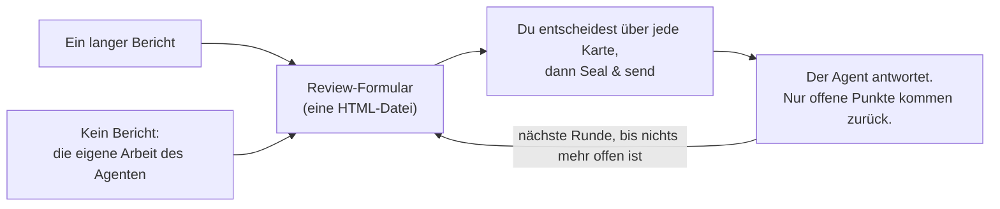

<div align="center">


# Granted · 准奏skill

**Prüfe lange KI-Berichte wie ein Kaiser.**

Deine KI schreibt die Denkschrift. Du hältst den Zinnoberpinsel.

[English](README.md) · [简体中文](README.zh-CN.md) · [繁體中文](README.zh-TW.md) · [日本語](README.ja.md) · [한국어](README.ko.md) · [Español](README.es.md) · [Français](README.fr.md) · **Deutsch** · [Português (Brasil)](README.pt-BR.md) · [Русский](README.ru.md)

[](#installation)
[](#was-du-bekommst)
[](#was-du-bekommst)
[](LICENSE)

<a href="assets/granted-demo.mp4"></a>

⭐ **Wenn Granted dir hilft, gib ihm bitte einen Stern.** Das hilft anderen, es zu finden.

</div>

---

## Warum

KI-Agenten schreiben heute lange Berichte: Audits, Migrationspläne, Design-Reviews, Forschungszusammenfassungen. Ein typischer Bericht hat 10–50 Punkte, bei denen **du** etwas entscheiden, freigeben oder korrigieren musst.

Den Bericht zu lesen ist kein Problem. **Feedback zu geben ist der mühsame Teil.** Du scrollst, du zitierst, du tippst „zu Punkt 7 denke ich …“ in den Chat. Du verlierst den Überblick darüber, was du schon beantwortet hast. Der Agent missversteht, welchen Punkt du gemeint hast. Und nächste Woche kann niemand mehr sagen, was entschieden wurde oder auf welche Version des Textes sich das bezog.

Im kaiserlichen China schickten Minister lange Denkschriften (奏章) an den Thron. Der Kaiser antwortete nicht mit Aufsätzen. Er schrieb auf jede eine kurze Entscheidung mit Zinnobertinte. Die bekannteste kennt man aus jedem Palastdrama: 准奏, „Antrag genehmigt“. Daher kommt der Name Granted. **Granted gibt dir diese Rolle.** Der Agent legt für jeden Punkt eine eigene Karte an, mit den Belegen, den Optionen und seiner Empfehlung. Du entscheidest in einem Formular über jede Karte. Der Agent liest deine Antworten exakt, antwortet auf deine Kommentare und fragt nur bei dem erneut nach, was noch offen ist.

**Das Ergebnis: bessere Entscheidungen und besseres Feedback, mit weniger Aufwand.** Du siehst jede Entscheidung, und nichts wird übersprungen. Jede Antwort hat eine Begründung, wo sie eine braucht. Der Agent bekommt strukturierte Antworten statt eines Absatzes, den er deuten muss.

## Installation

Granted funktioniert in **Claude Code** und in **Codex**. Du brauchst Python 3.8 oder neuer. Für den optionalen Selbsttest brauchst du außerdem Chrome, Chromium oder Edge.

**Claude Code**

```
/plugin marketplace add HaoranZhang122/granted-review
/plugin install granted@granted-review
```

Oder kopiere `skills/granted/` nach `~/.claude/skills/` (für alle Projekte) oder nach `.claude/skills/` (für ein einzelnes Projekt).

**Codex**

```
codex plugin marketplace add HaoranZhang122/granted-review
codex plugin add granted@granted-review
```

Oder kopiere `skills/granted/` nach `~/.codex/skills/`.

## Verwendung



**1. Starten.** Gib dem Agenten einen langen Bericht, oder lass ihn den Bericht überspringen und dir sein Ergebnis als Review-Formular geben:

| Ausgangspunkt | Claude Code | Codex |
|---|---|---|
| Aus einem langen Bericht | `Use the granted skill to turn docs/migration-report.md into a review form. ultracode` | `$granted Turn docs/migration-report.md into a review form.` |
| Ohne Bericht | `Plan the database migration, and give me the result as a Granted review instead of a long report. ultracode` | `$granted Plan the database migration, and give me the result as a review form instead of a long report.` |

(Du kannst auch auf Deutsch schreiben, zum Beispiel: „Mach mit dem Skill granted aus docs/migration-report.md ein Review-Formular. ultracode“.)

In Codex ruft `$granted` den Skill auf.

**2. Antworten.** Öffne das Formular, das dir der Agent gibt, entscheide über jede Karte und klicke auf **Seal & send** (Versiegeln & senden). Sag dem Agenten „gespeichert“.

**3. Wiederholen.** Der Agent liest deine Antworten und schickt ein kürzeres Formular, nur mit den offenen Punkten, jeweils mit seiner Antwort auf deinen Kommentar. Wenn nichts mehr offen ist, schreibt er das endgültige Entscheidungsregister.

> **Der Ultracode-Modus wird dringend empfohlen.** Lass den Agenten bei einem langen Bericht einen Multi-Agent-Workflow ausführen: ein Autor pro Karte, ein unabhängiger Prüfer pro Karte, der sie mit der Quelle abgleicht, und ein Konsistenzdurchgang. Autoren, die lange Berichte verdichten, lassen oft Vorbehalte weg und ändern Zahlen. Die Prüfer fangen das ab. Schreib in Claude Code `ultracode` in den Prompt (dafür muss in `/config` die Einstellung „Dynamic workflows“ aktiv sein). Ohne Ultracode und in Codex führt der Agent dieselben Schritte für Autoren und Prüfer nacheinander aus: siehe [references/ultracode.md](skills/granted/references/ultracode.md) (auf Englisch).

**Sofort ausprobieren, ohne Agent:** Klone das Repo und öffne die Dateien in [`skills/granted/examples/demo/forms/`](skills/granted/examples/demo/forms/) in deinem Browser (GitHub selbst zeigt HTML-Dateien als Quellcode an). Sie enthalten ein fiktives Review einer Datenbankmigration: Runde 1 leer, Runde 1 so, wie ein Reviewer sie zurückgegeben hat, und Runde 2.

## Was du bekommst

**Für dich als Reviewer**
- **Eine Karte pro Entscheidung.** Jede Karte hat eine einzeilige Zusammenfassung, die Belege (klapp sie auf, wenn du zweifelst), Abbildungen, die Optionen mit ihren Kosten und Risiken und eine empfohlene Option.
- **Schnell entscheiden.** <kbd>A</kbd> übernimmt die Empfehlung. <kbd>1</kbd>–<kbd>9</kbd> wählen eine Option. <kbd>J</kbd>/<kbd>K</kbd> wechseln zwischen den Karten. <kbd>N</kbd> springt zur nächsten unbeantworteten Karte. <kbd>F</kbd> markiert eine Karte. <kbd>C</kbd> öffnet einen Kommentar. Auf jede Karte, über die du entscheidest, kommt ein Siegel: 准 Genehmigt in Zinnoberrot, dazu 改 Überarbeiten, 驳 Abgelehnt, 缓 Zurückgestellt und 问 Frage, jedes in einer eigenen Farbe.
- **Sag, wie sicher du bist.** Sicher, tendenziell oder unsicher. Wenn du unsicher bist, erklärt der Agent in der nächsten Runde mehr.
- **Begründungen, wo sie zählen.** Wenn du widersprichst, eine Änderung verlangst oder „Sonstiges“ wählst, springt der Cursor ins Kommentarfeld, damit du das in einem Satz begründest.
- **Seal & send.** Ein Klick listet auf, was unbeantwortet, unsicher oder ohne Begründung ist, speichert deine Antworten in der Datei und kopiert eine kurze Zusammenfassung für den Chat. Der Agent findet die gespeicherte Datei selbst, wenn sie im Ordner des Formulars, im Downloads-Ordner oder auf dem Desktop liegt; sonst gib ihm den Pfad.
- **Spätere Runden sind kurz.** Eine Tabelle mit allem, was bestätigt ist (du kannst jede Zeile wieder öffnen), und nur für jeden offenen Punkt eine Karte, mit deiner vorherigen Antwort und der Antwort des Agenten.

**Für den Agenten**
- Eine Python-CLI ohne Abhängigkeiten (`granted.py`): `init`, `check`, `build`, `receive`, `next-round`, `revise`, `rebuild`, `answers`, `status`, `selftest`.
- `check` prüft die Karten, die Links und die Abbildungen. Es gibt außerdem eine Punktzahl für einfache Sprache aus (etwa 80 % ASD-STE100, optional).
- `receive` weist eine Datei zurück, wenn sie zu einem anderen Review gehört, eine Entwurfsvorschau ist, nie gespeichert wurde, Karten hat, die vom ausgegebenen Formular abweichen, oder einen zweiten Antwortblock enthält. Ebenso weist es eine Antwort zurück, die keine Auswahl ihrer Karte ist.
- `next-round` ordnet jeden Punkt mit Begründung als „Bestätigt“ oder „Offen“ ein. Es schreibt `DECISIONS_after_R<n>.md` und entwirft den Kartensatz der nächsten Runde, mit einem `TODO(AI)` an jeder Stelle, an der eine Antwort fällig ist. Nichts kann ohne Entscheidung aus dem Review herausfallen.

**Fürs Protokoll**
- **Die Antworten stecken in der HTML-Datei selbst.** In Chrome und Edge öffnet das erste Speichern einen Speichern-Dialog: Wähle die Formulardatei selbst und bestätige „Ersetzen“; spätere Speichervorgänge schreiben dann direkt in diese Datei. Andere Browser und die VS-Code-Vorschau laden eine aktualisierte Kopie herunter.
- **Jede ausgegebene und zurückgegebene Datei wird eingefroren** (eine schreibgeschützte Kopie) und mit ihrem sha256 in `REVIEW_LOG.md` protokolliert. Jede Karte trägt einen Fingerabdruck ihres Textes, und `receive` gleicht ihn mit dem ausgegebenen Formular ab. So lässt sich jede Antwort auf den Kartensatz zurückführen, den du bekommen hast.
- **Versionen** heißen `R<round>.<revision>`. Optionsbuchstaben ändern nie ihre Bedeutung. Eine Revision (R1.1) korrigiert den Wortlaut und behält deine Antworten. Eine neue Runde (R2.0) fragt nur nach dem, was offen ist.
- **Von Grund auf privat.** Es gibt keinen Server, keinen Netzwerkaufruf und kein CDN. Eine Content-Security-Policy in der Datei blockiert jede Anfrage, die die Seite selbst stellen könnte (fetch, Bilder, Schriften, Frames, Formular-Posts); Links, die du anklickst, deckt sie nicht ab. Das Formular ist eine Datei auf deiner Festplatte. Bis eine Speicherung deine Antworten in die Formulardatei selbst schreibt, hält dein Browser eine Kopie in seinem lokalen Speicher, wo andere lokale HTML-Dateien sie lesen können. Das Formular löscht diese Kopie, wenn es in die Formulardatei speichert (eine heruntergeladene Kopie zählt nicht; eine Kopie, die dir das Formular noch anbietet, bleibt, bis du dich entscheidest), und entfernt Kopien, die älter als 30 Tage sind, sobald du ein Granted-Formular öffnest.

## Befehle

| Befehl | Was er macht |
|---|---|
| `granted.py init --dir review --slug NAME --title TEXT` | Legt den Review-Ordner und seine Konfiguration an. |
| `granted.py check --dir review --version R1.0` | Prüft die Karten. Gibt die Punktzahl für einfache Sprache aus. |
| `granted.py build --dir review --version R1.0 [--draft]` | Erstellt eine Vorschau (`--draft`) oder gibt das Formular aus: eine Arbeitskopie, eine eingefrorene Kopie und einen Logeintrag. |
| `granted.py receive --dir review --find` | Empfängt jede neu gespeicherte Fassung dieses Reviews aus dem Review-Ordner, ~/Downloads und ~/Desktop, die älteste zuerst (oder gib `--file SAVED.html` an). Friert jede davon ein, extrahiert ihre Antworten (`.md` und `.json`) und protokolliert sie. |
| `granted.py next-round --dir review [--dry-run] [--open ID ...]` | Klassifiziert die Antworten. Schreibt die Entscheidungsdatei und entwirft die nächste Runde. |
| `granted.py revise --dir review --from R1.0 --to R1.1` | Kopiert einen Kartensatz für eine Revision. |
| `granted.py build --dir review --version R1.1 --carry SAVED.html` | Gibt eine Revision aus, die die Antworten der Runde behält. |
| `granted.py rebuild --dir review --version R1.0 --out FILE` | Baut ein ausgegebenes Formular aus dem Log neu und vergleicht es Byte für Byte. |
| `granted.py answers SAVED.html` | Gibt die Antworten eines beliebigen Formulars aus. Protokolliert nichts. |
| `granted.py status --dir review` | Zeigt das Log und den Stand des Reviews. |
| `granted.py selftest FORM.html` | Führt den eingebauten Selbsttest des Formulars in einem Headless-Browser aus. |

Die Details stehen in [SKILL.md](skills/granted/SKILL.md) und [references/](skills/granted/references/) (auf Englisch): das Kartenschema, wie man Karten schreibt, Regeln für einfache Sprache, Runden und Versionen und das Ultracode-Rezept.

## Häufige Fragen

**Welcher Browser?** In Chrome oder Edge fragt das erste Speichern, wohin gespeichert werden soll: Wähle die Formulardatei selbst. Firefox, Safari und die VS-Code-Vorschau funktionieren auch: Speichern lädt eine aktualisierte Kopie herunter. Gib diese Kopie dem Agenten.

**Ich habe den Tab ohne Speichern geschlossen.** Öffne dieselbe Datei innerhalb von 30 Tagen im selben Browser. Das Formular bietet dir die Antworten an, die der Browser behalten hat: Klicke auf **Use the browser answers**.

**Kann ich mich darauf verlassen, was laut Agent entschieden wurde?** Die Entscheidungsdatei führt jeden Punkt mit seinem Status und der Begründung auf. Jede Antwort lässt sich auf eine eingefrorene Kopie der von dir gespeicherten Datei zurückführen, samt ihrem sha256. Deine Kommentare erreichen den Agenten in deinen eigenen Worten. Der Agent liest jeden Kommentar und antwortet in der nächsten Runde auf jeder offenen Karte.

**Funktioniert es mit anderen Agenten (Cursor, Gemini CLI)?** Claude Code und Codex werden direkt unterstützt (siehe Installation). Die CLI ist reines Python, und SKILL.md ist reines Markdown. Deshalb kann auch jeder andere Agent, der eine Datei lesen und einen Befehl ausführen kann, den Anweisungen in SKILL.md folgen.

**Werden meine Daten irgendwohin gesendet?** Nein. Das Formular stellt keine Netzwerkanfragen, und seine Content-Security-Policy blockiert jede Anfrage, die die Seite selbst stellen könnte. Abbildungen sind in die Datei eingebettet.

## Star-Verlauf

Wenn Granted dir Zeit spart, ist ein ⭐ der einfachste Weg, Danke zu sagen und anderen zu helfen, es zu finden.

<a href="https://star-history.com/#HaoranZhang122/granted-review&Date">
  <picture>
    <source media="(prefers-color-scheme: dark)" srcset="https://api.star-history.com/svg?repos=HaoranZhang122/granted-review&type=Date&theme=dark" />
    <source media="(prefers-color-scheme: light)" srcset="https://api.star-history.com/svg?repos=HaoranZhang122/granted-review&type=Date" />
    
  </picture>
</a>

## Autor

Haoran Jack Zhang · [@HaoranZhang122](https://github.com/HaoranZhang122)

Fragen und Ideen: [eröffne ein Issue](https://github.com/HaoranZhang122/granted-review/issues).

## Lizenz

BSD-2-Clause. Siehe [LICENSE](LICENSE).
