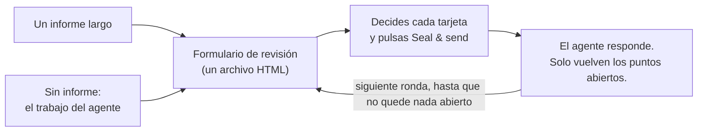

<div align="center">


# Vermilion · 朱批skill

**Revisa los informes largos de tu IA como un emperador.**

Tu IA escribe el memorial. Tú tienes el pincel bermellón.

[English](README.md) · [简体中文](README.zh-CN.md) · [繁體中文](README.zh-TW.md) · [日本語](README.ja.md) · **Español**

[](#instalación)
[](#qué-obtienes)
[](#qué-obtienes)
[](LICENSE)

<a href="assets/vermilion-demo.mp4"></a>

⭐ **Si Vermilion te resulta útil, dale una estrella.** Así otras personas pueden encontrarlo.

</div>

---

## Por qué

Los agentes de IA ya escriben informes largos: auditorías, planes de migración, revisiones de diseño, resúmenes de investigación. Uno típico tiene entre 10 y 50 puntos en los que **tú** debes decidir, aprobar o corregir algo.

Leer el informe no es el problema. **Dar la respuesta es lo difícil.** Te desplazas, citas, escribes "sobre el punto 7, creo que…" en el chat. Pierdes la cuenta de lo que ya contestaste. El agente entiende mal a qué punto te refieres. Y a la semana siguiente nadie sabe qué se decidió, ni sobre qué versión del texto.

En la China imperial, los ministros enviaban largos memoriales (奏章) al trono. El emperador no respondía con ensayos: escribía una decisión breve en tinta bermellón sobre cada uno, el 朱批. **Vermilion te da ese papel.** El agente pone cada punto en su propia tarjeta, con la evidencia, las opciones y su recomendación. Tú decides cada tarjeta en un formulario. El agente lee tus respuestas con exactitud, contesta a tus comentarios y solo vuelve a preguntar por lo que sigue abierto.

**El resultado: mejores decisiones y mejores comentarios, con menos esfuerzo.** Ves cada decisión y nada se pasa por alto. Cada respuesta tiene un motivo donde lo necesita. El agente recibe respuestas estructuradas en lugar de un párrafo que interpretar.

## Instalación

**Como plugin de Claude Code:**

```
/plugin marketplace add HaoranZhang122/vermilion-review
/plugin install vermilion@vermilion-review
```

**O como skill normal:** copia `skills/vermilion/` en `~/.claude/skills/` (para todos los proyectos) o en `.claude/skills/` (para un proyecto).

Necesitas Python 3.8 o posterior. Para la autoprueba opcional, también Chrome, Chromium o Edge.

## Cómo usarlo



**1. Empieza.** Dale al agente un informe largo, o deja que se salte el informe y te entregue su resultado como formulario de revisión:

```
Use vermilion to turn docs/migration-report.md into a review form. ultracode
```

```
Plan the database migration, and give me the result as a Vermilion review instead of a long report. ultracode
```

(También puedes pedirlo en español, por ejemplo: "Usa vermilion para convertir docs/migration-report.md en un formulario de revisión. ultracode".)

**2. Responde.** Abre el formulario que te da el agente, decide cada tarjeta y pulsa **Seal & send**. Dile al agente "guardado".

**3. Repite.** El agente lee tus respuestas y te envía un formulario más corto, solo con los puntos abiertos, cada uno con su respuesta a tu comentario. Cuando no queda nada abierto, escribe el registro final de decisiones.

> **Se recomienda encarecidamente el modo Ultracode.** Con un informe largo, deja que el agente ejecute un flujo con varios agentes: un redactor por tarjeta, un verificador independiente por tarjeta que la compara con la fuente, y una revisión de coherencia. Los redactores que resumen informes largos pierden matices y cambian cifras. Los verificadores lo detectan. Consulta [references/ultracode.md](skills/vermilion/references/ultracode.md) (en inglés).

**Pruébalo ahora, sin agente:** clona el repositorio y abre en tu navegador los archivos de [`skills/vermilion/examples/demo/forms/`](skills/vermilion/examples/demo/forms/) (GitHub muestra los archivos HTML como código fuente). Contienen una revisión ficticia de una migración de base de datos: la ronda 1 vacía, la ronda 1 tal como la devolvió un revisor, y la ronda 2.

## Qué obtienes

**Para ti, el revisor**
- **Una tarjeta por decisión.** Cada tarjeta tiene un resumen de una línea, la evidencia (despliégala si dudas), figuras, las opciones con sus costes y riesgos, y una opción recomendada.
- **Decide rápido.** <kbd>A</kbd> acepta la recomendación. <kbd>1</kbd>–<kbd>9</kbd> eligen una opción. <kbd>J</kbd>/<kbd>K</kbd> pasan de tarjeta. <kbd>N</kbd> salta a la siguiente sin respuesta. <kbd>F</kbd> marca una tarjeta para hablarla. <kbd>C</kbd> abre un comentario. Un sello bermellón (准 Aprobado, 改 Revisar, 驳 Rechazado, 缓 Aplazado, 问 Pregunta) marca cada tarjeta que decides.
- **Di cuánto lo tienes claro.** Seguro, inclinado o inseguro. Si no estás seguro, el agente explica más en la siguiente ronda.
- **Motivos donde importan.** Si no estás de acuerdo, pides un cambio o eliges "Otra", el cursor va al cuadro de comentario para que escribas una frase con el motivo.
- **Seal & send.** Un clic muestra lo que falta por responder, lo inseguro o lo que no tiene motivo, guarda tus respuestas en el archivo y copia un resumen breve para el chat. El agente encuentra solo el archivo guardado si está en la carpeta del formulario, en Descargas o en el Escritorio; si no, dale la ruta.
- **Las rondas siguientes son cortas.** Una tabla con todo lo confirmado (puedes reabrir cualquier fila) y una tarjeta solo para cada punto abierto, con tu respuesta anterior y la respuesta del agente.

**Para el agente**
- Una CLI en Python sin dependencias (`vermilion.py`): `init`, `check`, `build`, `receive`, `next-round`, `revise`, `rebuild`, `answers`, `status`, `selftest`.
- `check` valida las tarjetas, los enlaces y las figuras. También da una puntuación de lenguaje claro (en torno al 80 % de ASD-STE100, opcional).
- `receive` rechaza un archivo de otra revisión, un borrador, un archivo que nunca se guardó o un archivo cuyas tarjetas no coinciden con el formulario emitido.
- `next-round` clasifica cada punto como Confirmado o Abierto, con el motivo. Escribe `DECISIONS_after_R<n>.md` y prepara las tarjetas de la ronda siguiente, con un `TODO(AI)` en cada sitio donde falta una respuesta. Ningún punto puede salir de la revisión sin una decisión.

**Para el registro**
- **Las respuestas viven dentro del archivo HTML.** En Chrome y Edge, el primer guardado abre un diálogo: elige el propio archivo del formulario y confirma que lo reemplazas; los guardados siguientes escriben directamente en él. Otros navegadores y la vista previa de VS Code descargan una copia actualizada.
- **Cada archivo emitido y devuelto se congela** (una copia de solo lectura) y se registra con su sha256 en `REVIEW_LOG.md`. Cada tarjeta lleva una huella de su texto, y `receive` la compara con el formulario emitido, así que cada respuesta remite al conjunto de tarjetas que recibiste.
- **Las versiones** son `R<ronda>.<revisión>`. Las letras de las opciones nunca cambian de significado. Una revisión (R1.1) corrige la redacción y conserva tus respuestas. Una ronda nueva (R2.0) solo pregunta lo que sigue abierto.
- **Privado por diseño.** Sin servidor, sin llamadas de red y sin CDN. El formulario es un archivo en tu disco.

## Comandos

| Comando | Qué hace |
|---|---|
| `vermilion.py init --dir review --slug NAME --title TEXT` | Crea la carpeta de la revisión y su configuración. |
| `vermilion.py check --dir review --version R1.0` | Valida las tarjetas y da la puntuación de lenguaje claro. |
| `vermilion.py build --dir review --version R1.0 [--draft]` | Crea una vista previa (`--draft`) o emite el formulario: una copia de trabajo, una copia congelada y una entrada en el registro. |
| `vermilion.py receive --dir review --find` | Recibe, de la más antigua a la más nueva, cada copia guardada de esta revisión en la carpeta de la revisión, ~/Downloads y ~/Desktop (o indica `--file SAVED.html`). Congela cada una, extrae sus respuestas (`.md` y `.json`) y las registra. |
| `vermilion.py next-round --dir review [--dry-run] [--open ID ...]` | Clasifica las respuestas, escribe el archivo de decisiones y prepara la ronda siguiente. |
| `vermilion.py revise --dir review --from R1.0 --to R1.1` | Copia un conjunto de tarjetas para una revisión. |
| `vermilion.py build --dir review --version R1.1 --carry SAVED.html` | Emite una revisión que conserva las respuestas de la ronda. |
| `vermilion.py rebuild --dir review --version R1.0 --out FILE` | Reconstruye un formulario emitido a partir del registro y lo compara byte a byte. |
| `vermilion.py answers SAVED.html` | Muestra las respuestas de cualquier formulario. No registra nada. |
| `vermilion.py status --dir review` | Muestra el registro y en qué punto está la revisión. |
| `vermilion.py selftest FORM.html` | Ejecuta la autoprueba del formulario en un navegador sin interfaz. |

Los detalles están en [SKILL.md](skills/vermilion/SKILL.md) y en [references/](skills/vermilion/references/) (en inglés): el esquema de las tarjetas, cómo escribirlas, las reglas de lenguaje claro, las rondas y versiones, y la receta de Ultracode.

## Preguntas frecuentes

**¿Qué navegador?** En Chrome o Edge, el primer guardado pregunta dónde guardar: elige el propio archivo del formulario. Firefox, Safari y la vista previa de VS Code también sirven: al guardar se descarga una copia actualizada. Dale esa copia al agente.

**Cerré la pestaña sin guardar.** Abre el mismo archivo en el mismo navegador. El formulario te ofrece las respuestas que guardó el navegador.

**¿Puedo fiarme de lo que el agente dice que se decidió?** El archivo de decisiones lista cada punto con su estado y el motivo. Cada respuesta remite a una copia congelada del archivo que guardaste, con su sha256. Tus comentarios llegan al agente como palabras tuyas. El agente lee cada comentario y responde en cada tarjeta abierta de la ronda siguiente.

**¿Funciona con otros agentes (Codex, Cursor, Gemini CLI)?** La CLI es Python normal y SKILL.md es Markdown normal. Cualquier agente que pueda leer un archivo y ejecutar un comando puede seguirlo.

**¿Se envían mis datos a algún sitio?** No. El formulario no hace ninguna petición de red. Las figuras van incrustadas en el archivo.

## Historial de estrellas

Si Vermilion te ahorra tiempo, una ⭐ es la forma más sencilla de dar las gracias y de ayudar a que otros lo encuentren.

<a href="https://star-history.com/#HaoranZhang122/vermilion-review&Date">
  <picture>
    <source media="(prefers-color-scheme: dark)" srcset="https://api.star-history.com/svg?repos=HaoranZhang122/vermilion-review&type=Date&theme=dark" />
    <source media="(prefers-color-scheme: light)" srcset="https://api.star-history.com/svg?repos=HaoranZhang122/vermilion-review&type=Date" />
    
  </picture>
</a>

## Autor

Haoran Jack Zhang · [@HaoranZhang122](https://github.com/HaoranZhang122)

## Licencia

MIT. Consulta [LICENSE](LICENSE).
