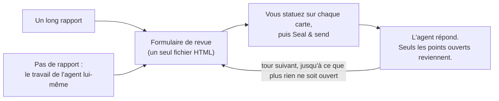

<div align="center">


# Granted · 准奏skill

**Examinez les longs rapports d'IA comme un empereur.**

Votre IA rédige le mémoire. Vous tenez le pinceau vermillon.

[English](README.md) · [简体中文](README.zh-CN.md) · [繁體中文](README.zh-TW.md) · [日本語](README.ja.md) · [한국어](README.ko.md) · [Español](README.es.md) · **Français** · [Deutsch](README.de.md) · [Português (Brasil)](README.pt-BR.md) · [Русский](README.ru.md)

[](#installation)
[](#ce-que-vous-obtenez)
[](#ce-que-vous-obtenez)
[](LICENSE)

<a href="assets/granted-demo.mp4"></a>

⭐ **Si Granted vous est utile, merci de lui donner une étoile.** Cela aide d'autres personnes à le trouver.

</div>

---

## Pourquoi

Les agents d'IA écrivent désormais de longs rapports : audits, plans de migration, revues de conception, synthèses de recherche. Un rapport typique compte 10 à 50 points sur lesquels **vous** devez décider, approuver ou corriger quelque chose.

Lire le rapport, ça va. **C'est le retour qui est pénible.** Vous faites défiler, vous citez, vous tapez « pour le point 7, je pense que… » dans le chat. Vous ne savez plus à quoi vous avez répondu. L'agent se trompe sur le point que vous visiez. Et la semaine suivante, personne ne peut dire ce qui a été décidé, ni sur quelle version du texte.

Dans la Chine impériale, les ministres adressaient au trône de longs mémoires (奏章). L'empereur ne répondait pas par des dissertations. Il écrivait sur chacun une courte décision à l'encre vermillon. La plus célèbre, celle de tous les drames de palais, est 准奏 : « requête accordée ». C'est de là que vient le nom. **Granted vous donne ce rôle.** L'agent place chaque point sur sa propre carte, avec les preuves, les options et sa recommandation. Vous statuez sur chaque carte dans un formulaire. L'agent lit vos réponses telles quelles, répond à vos commentaires et ne vous interroge à nouveau que sur ce qui reste ouvert.

**Le résultat : de meilleures décisions et de meilleurs retours, avec moins d'effort.** Vous voyez chaque décision, et rien n'est laissé de côté. Chaque réponse a une justification là où il en faut une. L'agent reçoit des réponses structurées au lieu d'un paragraphe à interpréter.

## Installation

Granted fonctionne dans **Claude Code** et dans **Codex**. Il vous faut Python 3.8 ou une version plus récente. Pour lancer l'autotest facultatif, il vous faut aussi Chrome, Chromium ou Edge.

**Claude Code**

```
/plugin marketplace add HaoranZhang122/granted-review
/plugin install granted@granted-review
```

Ou copiez `skills/granted/` dans `~/.claude/skills/` (pour tous les projets) ou dans `.claude/skills/` (pour un seul projet).

**Codex**

```
codex plugin marketplace add HaoranZhang122/granted-review
codex plugin add granted@granted-review
```

Ou copiez `skills/granted/` dans `~/.codex/skills/`.

## Utilisation



**1. Commencez.** Donnez un long rapport à l'agent, ou laissez-le se passer du rapport et vous remettre son résultat sous forme de formulaire de revue :

| Point de départ | Claude Code | Codex |
|---|---|---|
| À partir d'un long rapport | `Use the granted skill to turn docs/migration-report.md into a review form. ultracode` | `$granted Turn docs/migration-report.md into a review form.` |
| Sans rapport | `Plan the database migration, and give me the result as a Granted review instead of a long report. ultracode` | `$granted Plan the database migration, and give me the result as a review form instead of a long report.` |

(Vous pouvez aussi le demander en français, par exemple : « Utilise le skill granted pour transformer docs/migration-report.md en formulaire de revue. ultracode ».)

Dans Codex, `$granted` appelle le skill.

**2. Répondez.** Ouvrez le formulaire que l'agent vous donne, statuez sur chaque carte et cliquez sur **Seal & send** (sceller et envoyer). Dites à l'agent « enregistré ».

**3. Recommencez.** L'agent lit vos réponses et vous envoie un formulaire plus court, avec seulement les points ouverts, chacun avec sa réponse à votre commentaire. Quand plus rien n'est ouvert, il rédige le registre final des décisions.

> **Le mode Ultracode est vivement recommandé.** Pour un long rapport, laissez l'agent exécuter un workflow multi-agents : un rédacteur par carte, un vérificateur indépendant par carte qui la contrôle par rapport à la source, et une passe de cohérence. Les rédacteurs qui condensent de longs rapports suppriment souvent les réserves et modifient les chiffres. Les vérificateurs le repèrent. Dans Claude Code, ajoutez `ultracode` à votre prompt (cela nécessite le réglage « Dynamic workflows » dans `/config`). Sans Ultracode, et dans Codex, l'agent suit les mêmes étapes du rédacteur et du vérificateur l'une après l'autre : voir [references/ultracode.md](skills/granted/references/ultracode.md) (en anglais).

**Essayez tout de suite, sans agent :** clonez le dépôt et ouvrez dans votre navigateur les fichiers de [`skills/granted/examples/demo/forms/`](skills/granted/examples/demo/forms/) (GitHub lui-même affiche les fichiers HTML sous forme de code source). Ils contiennent une revue fictive d'une migration de base de données : le tour 1 vide, le tour 1 tel qu'un relecteur l'a renvoyé, et le tour 2.

## Ce que vous obtenez

**Pour vous, le relecteur**
- **Une carte par décision.** Chaque carte comporte un résumé d'une ligne, les preuves (dépliez-les en cas de doute), des figures, les options avec leurs coûts et leurs risques, et une option recommandée.
- **Statuez vite.** <kbd>A</kbd> accepte la recommandation. <kbd>1</kbd>–<kbd>9</kbd> choisissent une option. <kbd>J</kbd>/<kbd>K</kbd> passent d'une carte à l'autre. <kbd>N</kbd> saute à la prochaine carte sans réponse. <kbd>F</kbd> signale une carte. <kbd>C</kbd> ouvre un commentaire. Un sceau s'appose sur chaque carte que vous tranchez : 准 Approuvé en vermillon, et 改 À revoir, 驳 Rejeté, 缓 Reporté et 问 Question, chacun dans sa propre couleur.
- **Indiquez votre degré de certitude.** Sûr, plutôt sûr ou pas sûr. Si vous n'êtes pas sûr, l'agent donne plus d'explications au tour suivant.
- **Des justifications là où elles comptent.** Si vous n'êtes pas d'accord, si vous demandez une modification ou si vous choisissez « Autre », le curseur va dans la zone de commentaire pour une phrase de justification.
- **Seal & send.** Un clic liste ce qui est sans réponse, incertain ou sans justification, enregistre vos réponses dans le fichier et copie un court résumé pour le chat. L'agent trouve tout seul le fichier enregistré s'il se trouve dans le dossier du formulaire, dans Téléchargements ou sur le Bureau ; sinon, donnez-lui le chemin.
- **Les tours suivants sont courts.** Un tableau de tout ce qui est confirmé (vous pouvez rouvrir une ligne), et une carte seulement pour chaque point ouvert, avec votre réponse précédente et la réponse de l'agent.

**Pour l'agent**
- Une CLI Python sans aucune dépendance (`granted.py`) : `init`, `check`, `build`, `receive`, `next-round`, `revise`, `rebuild`, `answers`, `status`, `selftest`.
- `check` valide les cartes, les liens et les figures. Il donne aussi un score de langage clair (environ 80 % ASD-STE100, facultatif).
- `receive` refuse un fichier d'une autre revue, un aperçu de brouillon, un fichier non enregistré, un fichier dont les cartes diffèrent du formulaire émis, un fichier qui contient un second bloc de réponses, et une réponse qui n'est pas un choix de sa carte.
- `next-round` classe chaque point en Confirmé ou Ouvert, avec une justification. Il écrit `DECISIONS_after_R<n>.md` et prépare le jeu de cartes du tour suivant, avec un `TODO(AI)` à chaque endroit où une réponse est attendue. Aucun point ne peut sortir de la revue sans décision.

**Pour les archives**
- **Les réponses vivent dans le fichier HTML.** Dans Chrome et Edge, le premier enregistrement ouvre la boîte de dialogue d'enregistrement : choisissez le fichier du formulaire lui-même et confirmez le remplacement ; les enregistrements suivants écrivent directement dedans. Les autres navigateurs et l'aperçu de VS Code téléchargent une copie mise à jour.
- **Chaque fichier émis et renvoyé est figé** (une copie en lecture seule) et consigné avec son sha256 dans `REVIEW_LOG.md`. Chaque carte porte une empreinte de son texte, et `receive` la compare au formulaire émis : chaque réponse renvoie ainsi au jeu de cartes qui vous a été remis.
- **Les versions** sont de la forme `R<round>.<revision>`. Les lettres des options ne changent jamais de sens. Une révision (R1.1) corrige la formulation et conserve vos réponses. Un nouveau tour (R2.0) ne demande que ce qui est ouvert.
- **Privé par construction.** Pas de serveur, pas d'appel réseau, pas de CDN. Une Content-Security-Policy dans le fichier bloque toute requête que la page pourrait faire d'elle-même (fetch, images, polices, cadres, envois de formulaire) ; elle ne couvre pas les liens sur lesquels vous cliquez. Le formulaire est un seul fichier sur votre disque. Tant qu'un enregistrement n'a pas écrit vos réponses dans le fichier du formulaire lui-même, votre navigateur en garde une copie dans son stockage local, où d'autres fichiers HTML locaux peuvent la lire. Le formulaire supprime cette copie quand il enregistre dans le fichier du formulaire (une copie téléchargée ne compte pas ; une copie que le formulaire vous propose encore reste jusqu'à ce que vous choisissiez) et efface les copies de plus de 30 jours chaque fois que vous ouvrez un formulaire Granted.

## Commandes

| Commande | Ce qu'elle fait |
|---|---|
| `granted.py init --dir review --slug NAME --title TEXT` | Crée le dossier de la revue et sa configuration. |
| `granted.py check --dir review --version R1.0` | Valide les cartes. Indique le score de langage clair. |
| `granted.py build --dir review --version R1.0 [--draft]` | Construit un aperçu (`--draft`), ou émet le formulaire : une copie de travail, une copie figée et une entrée dans le journal. |
| `granted.py receive --dir review --find` | Reçoit chaque nouvel enregistrement de cette revue dans le dossier de la revue, ~/Downloads et ~/Desktop, du plus ancien au plus récent (ou indiquez `--file SAVED.html`). Fige chacun, extrait ses réponses (`.md` et `.json`) et les consigne dans le journal. |
| `granted.py next-round --dir review [--dry-run] [--open ID ...]` | Classe les réponses. Écrit le fichier des décisions et prépare le tour suivant. |
| `granted.py revise --dir review --from R1.0 --to R1.1` | Copie un jeu de cartes pour une révision. |
| `granted.py build --dir review --version R1.1 --carry SAVED.html` | Émet une révision qui conserve les réponses du tour. |
| `granted.py rebuild --dir review --version R1.0 --out FILE` | Reconstruit un formulaire émis à partir du journal et le compare octet par octet. |
| `granted.py answers SAVED.html` | Affiche les réponses de n'importe quel formulaire. Ne consigne rien. |
| `granted.py status --dir review` | Affiche le journal et l'état d'avancement de la revue. |
| `granted.py selftest FORM.html` | Lance l'autotest intégré du formulaire dans un navigateur sans interface. |

Les détails se trouvent dans [SKILL.md](skills/granted/SKILL.md) et dans [references/](skills/granted/references/) (en anglais) : le schéma des cartes, comment rédiger les cartes, les règles de langage clair, les tours et les versions, et la recette Ultracode.

## Questions fréquentes

**Quel navigateur ?** Dans Chrome ou Edge, le premier enregistrement demande où enregistrer : choisissez le fichier du formulaire lui-même. Firefox, Safari et l'aperçu de VS Code fonctionnent aussi : l'enregistrement télécharge une copie mise à jour. Donnez cette copie à l'agent.

**J'ai fermé l'onglet sans enregistrer.** Ouvrez le même fichier dans le même navigateur dans les 30 jours. Le formulaire vous propose les réponses que le navigateur a conservées : cliquez sur **Use the browser answers**.

**Puis-je me fier à ce que l'agent dit avoir décidé ?** Le fichier des décisions liste chaque point avec son statut et la justification. Chaque réponse renvoie à une copie figée du fichier que vous avez enregistré, avec son sha256. Vos commentaires sont transmis à l'agent comme vos propres mots. L'agent lit chaque commentaire et répond sur chaque carte ouverte au tour suivant.

**Granted fonctionne-t-il avec d'autres agents (Cursor, Gemini CLI) ?** Claude Code et Codex sont pris en charge directement (voir Installation). La CLI est écrite en Python pur et SKILL.md en Markdown brut : tout autre agent capable de lire un fichier et d'exécuter une commande peut donc le suivre aussi.

**Mes données sont-elles envoyées quelque part ?** Non. Le formulaire ne fait aucune requête réseau, et sa Content-Security-Policy bloque toute requête que la page pourrait faire d'elle-même. Les figures sont intégrées au fichier.

## Historique des étoiles

Si Granted vous fait gagner du temps, une ⭐ est le moyen le plus simple de dire merci et d'aider d'autres personnes à le trouver.

<a href="https://star-history.com/#HaoranZhang122/granted-review&Date">
  <picture>
    <source media="(prefers-color-scheme: dark)" srcset="https://api.star-history.com/svg?repos=HaoranZhang122/granted-review&type=Date&theme=dark" />
    <source media="(prefers-color-scheme: light)" srcset="https://api.star-history.com/svg?repos=HaoranZhang122/granted-review&type=Date" />
    
  </picture>
</a>

## Auteur

Haoran Jack Zhang · [@HaoranZhang122](https://github.com/HaoranZhang122)

Questions et idées : [ouvrez une issue](https://github.com/HaoranZhang122/granted-review/issues).

## Licence

BSD-2-Clause. Voir [LICENSE](LICENSE).
