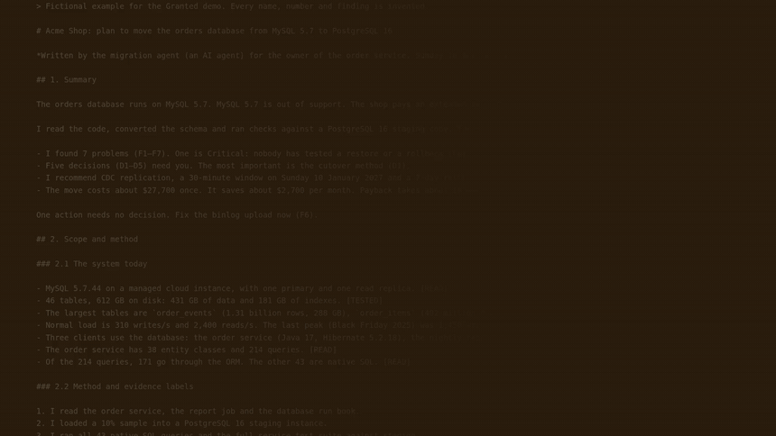
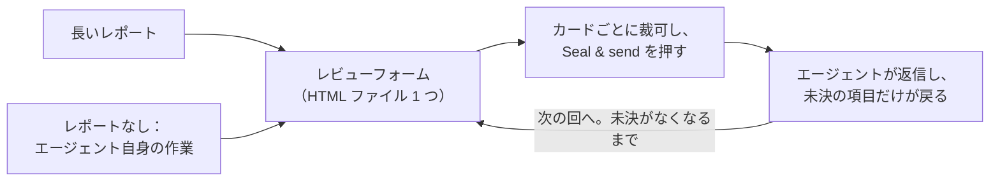

<div align="center">


# Granted · 准奏skill

**AI が書いた長いレポートを、皇帝のように裁可する。**

AI が上奏し、あなたが裁可する。

[English](README.md) · [简体中文](README.zh-CN.md) · [繁體中文](README.zh-TW.md) · **日本語** · [한국어](README.ko.md) · [Español](README.es.md) · [Français](README.fr.md) · [Deutsch](README.de.md) · [Português (Brasil)](README.pt-BR.md) · [Русский](README.ru.md)

[](#インストール)
[](#得られるもの)
[](#得られるもの)
[](LICENSE)

<a href="assets/granted-demo.mp4"></a>

⭐ **准奏skill が役に立ったら、Star をお願いします。** ほかの人が見つけやすくなります。

</div>

---

## なぜ必要か

いまの AI エージェントは長いレポートを書きます。監査、移行計画、設計レビュー、調査のまとめ。1 つのレポートに、**あなた**が決める・承認する・訂正すべき項目が 10〜50 個あるのは普通です。

レポートを読むのは問題ありません。**つらいのはフィードバックです。** スクロールし、引用し、チャットに「7 番目の項目について…」と打つ。どこまで答えたかを見失い、エージェントはどの項目のことか取り違えます。1 週間後には、何が決まったのか、どの版の文章に基づくのか、誰にも分かりません。

中国の皇帝は、臣下から届く長い上奏文（奏章）に長文で返事をしませんでした。朱墨で短い決定を書き込みました。中国の宮廷ドラマでいちばん有名な決定が「准奏」（上奏を許可する）です。英語名の Granted もここから来ています。**准奏skill はあなたにこの役割を与えます。** エージェントは各項目を 1 枚のカードにし、根拠・選択肢・推奨案を添えます。あなたはフォームでカードごとに裁可します。エージェントは回答を正確に読み取り、コメントに返信し、次の回ではまだ決まっていない項目だけを尋ねます。

**結果：より良い決定と、より良いフィードバックを、少ない手間で。** すべての決定が見え、取りこぼしがありません。理由が必要な所には理由があります。エージェントが受け取るのは、解釈が必要な文章ではなく構造化された回答です。

## インストール

准奏skill は **Claude Code** と **Codex** で使えます。Python 3.8 以上が必要です。任意のセルフテストを実行するには、Chrome、Chromium または Edge も必要です。

**Claude Code**

```
/plugin marketplace add HaoranZhang122/granted-review
/plugin install granted@granted-review
```

または、`skills/granted/` を `~/.claude/skills/`（すべてのプロジェクトで使う場合）または `.claude/skills/`（1 つのプロジェクトだけで使う場合）にコピーします。

**Codex**

```
codex plugin marketplace add HaoranZhang122/granted-review
codex plugin add granted@granted-review
```

または、`skills/granted/` を `~/.codex/skills/` にコピーします。

## 使い方



**1. 始める。** エージェントに長いレポートを渡します。または、レポートを省いて、結果を直接レビューフォームで出してもらいます：

| 始め方 | Claude Code | Codex |
|---|---|---|
| 長いレポートから | `Use the granted skill to turn docs/migration-report.md into a review form. ultracode` | `$granted Turn docs/migration-report.md into a review form.` |
| レポートなし | `Plan the database migration, and give me the result as a Granted review instead of a long report. ultracode` | `$granted Plan the database migration, and give me the result as a review form instead of a long report.` |

（日本語で頼んでも構いません。例：「granted スキルで docs/migration-report.md をレビューフォームにして。ultracode」）

Codex では、`$granted` でスキルを呼び出します。

**2. 回答する。** エージェントから届いたフォームを開き、カードごとに裁可して **Seal & send** を押します。エージェントに「保存した」と伝えます。

**3. 繰り返す。** エージェントは回答を読み、未決の項目だけを載せた短いフォームを送ります。各項目には、あなたのコメントへの返信が付きます。未決がなくなると、最終的な決定記録を書きます。

> **Ultracode モードを強く推奨します。** 長いレポートでは、エージェントにマルチエージェントのワークフローを実行させてください。カードごとに書き手を 1 人、元の資料と照合する独立した検証者をカードごとに 1 人置き、さらに一貫性チェックを行います。長いレポートを要約する書き手は、但し書きや留保を落とし、数字を変えてしまうことがよくあります。検証者がそれを見つけます。Claude Code では、プロンプトに `ultracode` を加えます（`/config` の「Dynamic workflows」設定が必要です）。Ultracode を使えない場合や Codex では、エージェントが書き手と検証者の手順を一つずつ順に行います。詳しくは [references/ultracode.md](skills/granted/references/ultracode.md)（英語）を参照してください。

**エージェントなしで今すぐ試す：** リポジトリをクローンし、[`skills/granted/examples/demo/forms/`](skills/granted/examples/demo/forms/) のファイルをブラウザで開きます（GitHub 上では HTML ファイルはソースコードとして表示されます）。中身は架空のデータベース移行レビューで、空の 1 回目、レビュアーが回答して返した 1 回目、そして 2 回目が入っています。

## 得られるもの

**レビュアー（あなた）にとって**
- **1 つの決定に 1 枚のカード。** 各カードには 1 行の要約、根拠（迷ったときに開く）、図、各選択肢のコストとリスク、推奨案が 1 つあります。
- **素早く裁可。** <kbd>A</kbd> で推奨案を承認、<kbd>1</kbd>〜<kbd>9</kbd> で選択肢を選択、<kbd>J</kbd>/<kbd>K</kbd> でカード間を移動、<kbd>N</kbd> で次の未回答カードへ、<kbd>F</kbd> で要相談の印、<kbd>C</kbd> でコメント。決めたカードには印が押されます。准（承認）は朱色、改（修正）・驳（却下）・缓（保留）・问（質問）はそれぞれ別の色です。
- **確信度を伝える。** 確信あり・やや・不確か。不確かな項目は、次の回でエージェントが詳しく説明します。
- **理由が必要な所で理由を。** 反対・修正・「その他」を選ぶと、カーソルがコメント欄に移り、1 文の理由を求めます。
- **Seal & send。** ワンクリックで、未回答・不確か・理由のないカードを一覧し、回答をファイルに保存し、チャット用の短い要約をコピーします。保存したファイルがフォームのフォルダ、ダウンロード、デスクトップにあれば、エージェントが自分で見つけます。それ以外はパスを伝えてください。
- **2 回目以降は短い。** 確定した項目を 1 つの表にまとめ（どの行も再び開けます）、未決の項目だけをカードにします。前回のあなたの回答とエージェントの返信も表示されます。

**エージェントにとって**
- 依存なしの Python CLI（`granted.py`）：`init`、`check`、`build`、`receive`、`next-round`、`revise`、`rebuild`、`answers`、`status`、`selftest`。
- `check` はカード・リンク・図を検証し、平易な英語のスコア（約 80% ASD-STE100、任意）も出します。
- `receive` は、別のレビューのファイル、下書きプレビュー、一度も保存されていないファイル、発行したフォームとカードが違うファイルを受け付けません。
- `next-round` は各項目を「確定」か「未決」に分け、理由を付けます。`DECISIONS_after_R<n>.md` を書き、次の回のカードを下書きし、返信が必要な所に `TODO(AI)` を残します。決定のないまま消える項目はありません。

**記録として**
- **回答は HTML ファイルの中に保存されます。** Chrome と Edge では、最初の保存で保存ダイアログが開きます。フォームのファイルそのものを選んで置き換えを確認すると、以後はそのファイルに直接書き込みます。他のブラウザと VS Code のプレビューは、更新したコピーをダウンロードします。
- **発行・返却されたファイルはすべて凍結され**（読み取り専用のコピー）、sha256 とともに `REVIEW_LOG.md` に記録されます。各カードは内容の指紋を持ち、`receive` が発行したフォームと照合するので、各回答はあなたが受け取ったカードの組までたどれます。
- **版**は `R<回>.<改訂>`。選択肢の文字の意味は決して変わりません。改訂（R1.1）は文言だけを直し、回答を引き継ぎます。新しい回（R2.0）は未決の項目だけを尋ねます。
- **プライバシー重視の設計。** サーバーもネットワーク通信も CDN もありません。フォームはディスク上の 1 つのファイルです。

## コマンド

| コマンド | 内容 |
|---|---|
| `granted.py init --dir review --slug NAME --title TEXT` | レビュー用フォルダと設定ファイルを作ります。 |
| `granted.py check --dir review --version R1.0` | カードを検証し、平易な英語のスコアを出します。 |
| `granted.py build --dir review --version R1.0 [--draft]` | プレビュー（`--draft`）を作るか、フォームを発行します（作業用コピー、凍結コピー、ログ）。 |
| `granted.py receive --dir review --find` | レビュー用フォルダ、~/Downloads、~/Desktop にあるこのレビューの新しい保存をすべて、古い順に受け取ります（`--file SAVED.html` で指定も可）。それぞれを凍結し、回答（`.md` と `.json`）を取り出して記録します。 |
| `granted.py next-round --dir review [--dry-run] [--open ID ...]` | 回答を分類し、決定ファイルを書き、次の回を下書きします。 |
| `granted.py revise --dir review --from R1.0 --to R1.1` | 改訂用にカードの組をコピーします。 |
| `granted.py build --dir review --version R1.1 --carry SAVED.html` | その回の回答を引き継ぐ改訂版を発行します。 |
| `granted.py rebuild --dir review --version R1.0 --out FILE` | ログから発行済みフォームを再構築し、バイト単位で比較します。 |
| `granted.py answers SAVED.html` | 任意のフォームの回答を表示します。記録はしません。 |
| `granted.py status --dir review` | ログとレビューの進み具合を表示します。 |
| `granted.py selftest FORM.html` | フォーム内蔵のセルフテストをヘッドレスブラウザで実行します。 |

詳細は [SKILL.md](skills/granted/SKILL.md) と [references/](skills/granted/references/)（英語）にあります。カードの形式、カードの書き方、平易な英語のルール、回と版、Ultracode のやり方です。

## よくある質問

**どのブラウザ？** Chrome または Edge では、最初の保存で保存先を尋ねられます。フォームのファイルそのものを選んでください。Firefox、Safari、VS Code のプレビューでも使えます。保存すると更新したコピーがダウンロードされるので、そのコピーをエージェントに渡してください。

**保存せずにタブを閉じた。** 同じブラウザで同じファイルを開いてください。ブラウザに残っている回答の復元を、フォームが提案します。

**エージェントが報告する決定は信用できる？** 決定ファイルには、すべての項目の状態と理由が載ります。各回答は、あなたが保存したファイルの凍結コピーとその sha256 までたどれます。コメントはあなたの言葉のままエージェントに渡り、エージェントはすべてのコメントを読み、次の回で未決カードごとに返信します。

**他のエージェント（Cursor、Gemini CLI）でも使える？** Claude Code と Codex には直接対応しています（「インストール」を参照）。CLI はただの Python、SKILL.md はただの Markdown なので、ファイルを読み、コマンドを実行できるエージェントであれば、ほかのエージェントでも手順どおりに使えます。

**データはどこかに送られる？** いいえ。フォームはネットワーク通信を一切しません。図はファイルに埋め込まれています。

## Star の推移

准奏skill で時間が節約できたら、⭐ がいちばん簡単なお礼になり、ほかの人が見つける助けにもなります。

<a href="https://star-history.com/#HaoranZhang122/granted-review&Date">
  <picture>
    <source media="(prefers-color-scheme: dark)" srcset="https://api.star-history.com/svg?repos=HaoranZhang122/granted-review&type=Date&theme=dark" />
    <source media="(prefers-color-scheme: light)" srcset="https://api.star-history.com/svg?repos=HaoranZhang122/granted-review&type=Date" />
    
  </picture>
</a>

## 作者

Haoran Jack Zhang · [@HaoranZhang122](https://github.com/HaoranZhang122)

質問やアイデアは [issue](https://github.com/HaoranZhang122/granted-review/issues) でどうぞ。

## ライセンス

MIT。[LICENSE](LICENSE) を参照。
