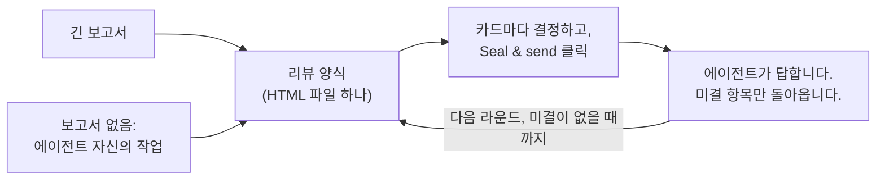

<div align="center">


# Granted · 准奏skill

**AI가 쓴 긴 보고서를 황제처럼 검토하세요.**

AI는 상소문을 씁니다. 붉은 붓은 당신이 듭니다.

[English](README.md) · [简体中文](README.zh-CN.md) · [繁體中文](README.zh-TW.md) · [日本語](README.ja.md) · **한국어** · [Español](README.es.md) · [Français](README.fr.md) · [Deutsch](README.de.md) · [Português (Brasil)](README.pt-BR.md) · [Русский](README.ru.md)

[](#설치)
[](#얻을-수-있는-것)
[](#얻을-수-있는-것)
[](LICENSE)

<a href="assets/granted-demo.mp4"></a>

⭐ **Granted가 도움이 되었다면 Star를 눌러 주세요.** 다른 사람들이 이 프로젝트를 찾는 데 도움이 됩니다.

</div>

---

## 왜 필요한가

이제 AI 에이전트는 긴 보고서를 씁니다. 감사, 마이그레이션 계획, 설계 리뷰, 연구 요약 같은 것들입니다. 보통 보고서 하나에는 **당신**이 결정하거나 승인하거나 바로잡아야 할 항목이 10–50개 있습니다.

보고서를 읽는 것까지는 괜찮습니다. **정말 힘든 것은 피드백을 주는 일입니다.** 스크롤하고, 인용하고, 채팅에 "7번 항목은 제 생각에…"라고 입력합니다. 어디까지 답했는지 놓치게 됩니다. 에이전트는 당신이 어느 항목을 말한 것인지 잘못 알아듣습니다. 그리고 다음 주가 되면 무엇이 결정되었는지, 어느 버전의 글을 기준으로 했는지 아무도 말하지 못합니다.

중국 왕조 시대에 신하들은 긴 상소문(奏章)을 황제에게 올렸습니다. 황제는 긴 글로 답하지 않았습니다. 상소문마다 붉은 먹으로 짧은 결정을 적었습니다. 중국 궁중 사극에서 가장 잘 알려진 결정은 准奏(준주), 곧 '윤허한다'입니다. Granted라는 이름도 여기서 왔습니다. **Granted는 당신에게 그 역할을 줍니다.** 에이전트는 모든 항목을 각각 카드 한 장에 담고, 근거와 선택지와 추천안을 붙입니다. 당신은 양식에서 카드마다 결정을 내립니다. 에이전트는 당신의 답을 정확히 읽고, 당신의 코멘트에 답하고, 아직 미결인 것만 다시 묻습니다.

**결과: 더 적은 노력으로 더 나은 결정과 더 나은 피드백.** 모든 결정이 보이고, 빠지는 것이 없습니다. 이유가 필요한 답에는 이유가 붙습니다. 에이전트는 해석해야 하는 문단 대신 구조화된 답을 받습니다.

## 설치

Granted는 **Claude Code**와 **Codex**에서 작동합니다. Python 3.8 이상이 필요합니다. 선택 사항인 셀프 테스트를 실행하려면 Chrome, Chromium 또는 Edge도 필요합니다.

**Claude Code**

```
/plugin marketplace add HaoranZhang122/granted-review
/plugin install granted@granted-review
```

또는 `skills/granted/`를 `~/.claude/skills/`(모든 프로젝트용) 또는 `.claude/skills/`(한 프로젝트용)에 복사합니다.

**Codex**

```
codex plugin marketplace add HaoranZhang122/granted-review
codex plugin add granted@granted-review
```

또는 `skills/granted/`를 `~/.codex/skills/`에 복사합니다.

## 사용 방법



**1. 시작하기.** 에이전트에게 긴 보고서를 주거나, 보고서는 건너뛰고 결과를 바로 리뷰 양식으로 달라고 하세요.

| 시작 방법 | Claude Code | Codex |
|---|---|---|
| 긴 보고서에서 | `Use the granted skill to turn docs/migration-report.md into a review form. ultracode` | `$granted Turn docs/migration-report.md into a review form.` |
| 보고서 없이 | `Plan the database migration, and give me the result as a Granted review instead of a long report. ultracode` | `$granted Plan the database migration, and give me the result as a review form instead of a long report.` |

(한국어로 요청해도 됩니다. 예: "granted 스킬로 docs/migration-report.md를 리뷰 양식으로 만들어 줘. ultracode")

Codex에서는 `$granted`로 스킬을 호출합니다.

**2. 답하기.** 에이전트가 준 양식을 열고, 카드마다 결정한 뒤 **Seal & send**(봉인 후 전송)를 클릭하세요. 에이전트에게 "저장했어"라고 말하세요.

**3. 반복하기.** 에이전트는 당신의 답을 읽고, 미결 항목만 담은 더 짧은 양식을 보냅니다. 각 항목에는 당신의 코멘트에 대한 답이 붙어 있습니다. 미결 항목이 없으면 최종 결정 기록을 작성합니다.

> **Ultracode 모드를 강력히 권장합니다.** 긴 보고서라면 에이전트가 멀티 에이전트 워크플로를 실행하게 하세요. 카드마다 작성자 한 명과, 그 카드를 원문과 대조하는 독립된 검증자 한 명을 두고, 일관성 점검도 한 번 거칩니다. 긴 보고서를 요약하는 작성자는 유보적인 표현을 빠뜨리고 숫자를 바꾸는 경우가 많습니다. 검증자가 이를 잡아냅니다. Claude Code에서는 프롬프트에 `ultracode`를 추가하세요(`/config`에서 'Dynamic workflows' 설정이 켜져 있어야 합니다). Ultracode를 쓸 수 없을 때나 Codex에서는 에이전트가 작성자 단계와 검증자 단계를 차례로 진행합니다. 자세한 내용은 [references/ultracode.md](skills/granted/references/ultracode.md)(영어)를 참고하세요.

**에이전트 없이 지금 바로 해 보기:** 저장소를 클론하고 [`skills/granted/examples/demo/forms/`](skills/granted/examples/demo/forms/)의 파일을 브라우저에서 여세요(GitHub에서는 HTML 파일이 소스 코드로 보입니다). 가상의 데이터베이스 마이그레이션 리뷰가 들어 있습니다. 비어 있는 1라운드, 리뷰어가 돌려준 상태의 1라운드, 그리고 2라운드입니다.

## 얻을 수 있는 것

**리뷰어인 당신을 위해**
- **결정 하나에 카드 한 장.** 각 카드에는 한 줄 요약, 근거(의심이 들 때 펼치세요), 그림, 비용과 위험이 적힌 선택지, 그리고 추천 선택지 하나가 있습니다.
- **빠르게 결정하기.** <kbd>A</kbd>는 추천안을 수락합니다. <kbd>1</kbd>–<kbd>9</kbd>는 선택지를 고릅니다. <kbd>J</kbd>/<kbd>K</kbd>는 카드 사이를 이동합니다. <kbd>N</kbd>은 답하지 않은 다음 카드로 건너뜁니다. <kbd>F</kbd>는 카드에 플래그를 표시합니다. <kbd>C</kbd>는 코멘트를 엽니다. 결정한 카드마다 인장이 찍힙니다. 准 승인은 붉은색이고, 改 수정, 驳 반려, 缓 보류, 问 질문은 각각 고유한 색입니다.
- **얼마나 확신하는지 알려 주세요.** 확실, 어느 정도 확신, 불확실 중에서 고릅니다. 불확실하면 에이전트가 다음 라운드에서 더 자세히 설명합니다.
- **필요한 곳에 이유를.** 반대하거나, 수정을 요청하거나, "기타"(Other)를 고르면 커서가 코멘트 칸으로 이동합니다. 이유를 한 문장으로 적으면 됩니다.
- **Seal & send.** 한 번의 클릭으로 답하지 않은 것, 불확실한 것, 이유가 없는 것을 보여 주고, 답을 파일에 저장하고, 채팅용 짧은 요약을 복사합니다. 저장된 파일이 양식의 폴더, 다운로드 또는 바탕 화면에 있으면 에이전트가 스스로 찾습니다. 그렇지 않으면 경로를 알려 주세요.
- **이후 라운드는 짧습니다.** 확정된 모든 것을 담은 표 하나(어느 행이든 다시 열 수 있습니다)와, 미결 항목마다 카드 한 장이 있습니다. 카드에는 당신의 이전 답과 에이전트의 답이 함께 있습니다.

**에이전트를 위해**
- 의존성이 없는 Python CLI(`granted.py`): `init`, `check`, `build`, `receive`, `next-round`, `revise`, `rebuild`, `answers`, `status`, `selftest`.
- `check`는 카드, 링크, 그림을 검증합니다. 쉬운 언어 점수(약 80% ASD-STE100, 선택 사항)도 알려 줍니다.
- `receive`는 다른 리뷰의 파일, 초안 미리보기, 저장하지 않은 파일, 카드가 발행된 양식과 다른 파일, 두 번째 답 블록이 들어 있는 파일, 그리고 카드의 선택지가 아닌 답을 거부합니다.
- `next-round`는 모든 항목을 확정 또는 미결로 나누고 이유를 붙입니다. `DECISIONS_after_R<n>.md`를 작성하고 다음 카드 세트의 초안을 만듭니다. 답이 필요한 곳마다 `TODO(AI)`를 남깁니다. 결정 없이 리뷰에서 빠질 수 있는 항목은 없습니다.

**기록을 위해**
- **답은 HTML 파일 안에 저장됩니다.** Chrome과 Edge에서는 첫 저장 때 저장 대화 상자가 열립니다. 양식 파일 자체를 선택하고 바꾸기를 확인하세요. 이후 저장은 그 파일에 바로 기록됩니다. 다른 브라우저와 VS Code 미리보기는 업데이트된 사본을 다운로드합니다.
- **발행하고 돌려받은 모든 파일은 동결되며**(읽기 전용 사본) sha256과 함께 `REVIEW_LOG.md`에 기록됩니다. 각 카드에는 그 카드 텍스트의 지문이 들어 있고, `receive`가 이를 발행된 양식과 대조합니다. 그래서 모든 답을 당신이 받은 카드 세트까지 추적할 수 있습니다.
- **버전**은 `R<라운드>.<개정>`입니다. 선택지 문자의 의미는 절대 바뀌지 않습니다. 개정(R1.1)은 문구를 고치고 당신의 답을 유지합니다. 새 라운드(R2.0)는 미결인 것만 묻습니다.
- **처음부터 비공개로 설계되었습니다.** 서버도, 네트워크 호출도, CDN도 없습니다. 파일 안의 Content-Security-Policy는 페이지가 스스로 보낼 수 있는 모든 요청(fetch, 이미지, 글꼴, 프레임, 양식 전송)을 막습니다. 직접 클릭한 링크는 막지 않습니다. 양식은 당신의 디스크에 있는 파일 하나입니다. 저장으로 답이 양식 파일 자체에 기록되기 전까지는 브라우저가 로컬 저장소에 사본을 보관하며, 다른 로컬 HTML 파일도 이를 읽을 수 있습니다. 양식 파일에 저장하면 양식이 이 사본을 지우고(다운로드한 사본은 해당하지 않으며, 양식이 아직 제안 중인 사본은 선택할 때까지 남습니다), Granted 양식을 열 때마다 30일이 지난 사본을 지웁니다.

## 명령어

| 명령어 | 하는 일 |
|---|---|
| `granted.py init --dir review --slug NAME --title TEXT` | 리뷰 폴더와 그 설정을 만듭니다. |
| `granted.py check --dir review --version R1.0` | 카드를 검증합니다. 쉬운 언어 점수를 보고합니다. |
| `granted.py build --dir review --version R1.0 [--draft]` | 미리보기(`--draft`)를 만들거나, 양식을 발행합니다. 발행하면 작업용 사본, 동결 사본, 로그 항목이 생깁니다. |
| `granted.py receive --dir review --find` | 리뷰 폴더, ~/Downloads, ~/Desktop에 있는 이 리뷰의 새 저장본을 모두 오래된 것부터 받습니다(또는 `--file SAVED.html`로 지정합니다). 각각을 동결하고, 답(`.md`와 `.json`)을 추출해 기록합니다. |
| `granted.py next-round --dir review [--dry-run] [--open ID ...]` | 답을 분류합니다. 결정 파일을 작성하고 다음 라운드의 초안을 만듭니다. |
| `granted.py revise --dir review --from R1.0 --to R1.1` | 개정을 위해 카드 세트를 복사합니다. |
| `granted.py build --dir review --version R1.1 --carry SAVED.html` | 해당 라운드의 답을 유지하는 개정판을 발행합니다. |
| `granted.py rebuild --dir review --version R1.0 --out FILE` | 로그를 바탕으로 발행된 양식을 다시 빌드하고 바이트 단위로 비교합니다. |
| `granted.py answers SAVED.html` | 어떤 양식이든 그 답을 출력합니다. 아무것도 기록하지 않습니다. |
| `granted.py status --dir review` | 로그와 리뷰의 진행 상황을 보여 줍니다. |
| `granted.py selftest FORM.html` | 양식에 내장된 셀프 테스트를 헤드리스 브라우저에서 실행합니다. |

자세한 내용은 [SKILL.md](skills/granted/SKILL.md)와 [references/](skills/granted/references/)(영어)에 있습니다. 카드 스키마, 카드 작성법, 쉬운 언어 규칙, 라운드와 버전, 그리고 Ultracode 레시피를 다룹니다.

## 자주 묻는 질문

**어떤 브라우저를 쓰나요?** Chrome이나 Edge에서는 첫 저장 때 어디에 저장할지 묻습니다. 양식 파일 자체를 선택하세요. Firefox, Safari, VS Code 미리보기에서도 작동합니다. 저장하면 업데이트된 사본이 다운로드됩니다. 그 사본을 에이전트에게 주세요.

**저장하지 않고 탭을 닫았어요.** 30일 안에 같은 브라우저에서 같은 파일을 여세요. 브라우저에 남아 있는 답을 양식이 제안합니다. **Use the browser answers**를 누르세요.

**에이전트가 결정했다고 말하는 내용을 믿어도 되나요?** 결정 파일에는 모든 항목이 상태와 이유와 함께 나열됩니다. 각 답은 당신이 저장한 파일의 동결 사본과 그 sha256까지 추적할 수 있습니다. 당신의 코멘트는 당신이 쓴 말 그대로 에이전트에게 전달됩니다. 에이전트는 모든 코멘트를 읽고, 다음 라운드에서 각 미결 카드에 답합니다.

**다른 에이전트(Cursor, Gemini CLI)에서도 작동하나요?** Claude Code와 Codex는 직접 지원합니다(설치 참고). CLI는 순수 Python이고 SKILL.md는 일반 Markdown이므로, 파일을 읽고 명령을 실행할 수 있는 다른 에이전트도 이를 따를 수 있습니다.

**내 데이터가 어딘가로 전송되나요?** 아니요. 양식은 네트워크 요청을 하지 않으며, Content-Security-Policy가 페이지가 스스로 보낼 수 있는 모든 요청을 막습니다. 그림은 파일 안에 포함되어 있습니다.

## Star 기록

Granted가 시간을 아껴 주었다면, ⭐는 고마움을 전하고 다른 사람들이 이 프로젝트를 찾도록 돕는 가장 쉬운 방법입니다.

<a href="https://star-history.com/#HaoranZhang122/granted-review&Date">
  <picture>
    <source media="(prefers-color-scheme: dark)" srcset="https://api.star-history.com/svg?repos=HaoranZhang122/granted-review&type=Date&theme=dark" />
    <source media="(prefers-color-scheme: light)" srcset="https://api.star-history.com/svg?repos=HaoranZhang122/granted-review&type=Date" />
    
  </picture>
</a>

## 작성자

Haoran Jack Zhang · [@HaoranZhang122](https://github.com/HaoranZhang122)

질문과 아이디어: [이슈 열기](https://github.com/HaoranZhang122/granted-review/issues).

## 라이선스

BSD-2-Clause. [LICENSE](LICENSE)를 참고하세요.
