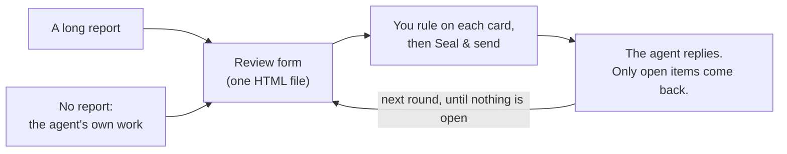

<div align="center">


# Granted · 准奏skill

**Review long AI reports like an emperor.**

Your AI writes the memorial. You hold the vermilion brush.

**English** · [简体中文](README.zh-CN.md) · [繁體中文](README.zh-TW.md) · [日本語](README.ja.md) · [한국어](README.ko.md) · [Español](README.es.md) · [Français](README.fr.md) · [Deutsch](README.de.md) · [Português (Brasil)](README.pt-BR.md) · [Русский](README.ru.md)

[](#install)
[](#what-you-get)
[](#what-you-get)
[](LICENSE)

<a href="assets/granted-demo.mp4"></a>

⭐ **If Granted helps you, please give it a star.** It helps other people find it.

</div>

---

## Why

AI agents now write long reports: audits, migration plans, design reviews, research summaries. A typical one has 10–50 items where **you** must decide, approve or correct something.

Reading the report is fine. **Giving feedback is the painful part.** You scroll, you quote, you type "for item 7, I think…" into the chat. You lose track of what you answered. The agent misreads which item you meant. And next week nobody can say what was decided, or on which version of the text.

In imperial China, ministers sent long memorials (奏章) to the throne. The emperor did not write essays back. He wrote a short ruling on each one in vermilion ink. The best-known ruling, from every palace drama, is 准奏: "request granted". That is where the name comes from. **Granted gives you that role.** The agent puts every item on its own card, with the evidence, the options and its recommendation. You rule on each card in a form. The agent reads your answers exactly, replies to your comments, and asks again only about what is still open.

**The result: better decisions and better feedback, with less effort.** You see every decision, and nothing is skipped. Each answer has a reason where it needs one. The agent gets structured answers instead of a paragraph to interpret.

## Install

Granted works in **Claude Code** and in **Codex**. You need Python 3.8 or later. To run the optional self-test, you also need Chrome, Chromium or Edge.

**Claude Code**

```
/plugin marketplace add HaoranZhang122/granted-review
/plugin install granted@granted-review
```

Or copy `skills/granted/` into `~/.claude/skills/` (for all projects) or into `.claude/skills/` (for one project).

**Codex**

```
codex plugin marketplace add HaoranZhang122/granted-review
codex plugin add granted@granted-review
```

Or copy `skills/granted/` into `~/.codex/skills/`.

## How to use



**1. Start.** Give the agent a long report, or let it skip the report and give you its result as a review form:

| Start | Claude Code | Codex |
|---|---|---|
| From a long report | `Use the granted skill to turn docs/migration-report.md into a review form. ultracode` | `$granted Turn docs/migration-report.md into a review form.` |
| No report | `Plan the database migration, and give me the result as a Granted review instead of a long report. ultracode` | `$granted Plan the database migration, and give me the result as a review form instead of a long report.` |

In Codex, `$granted` calls the skill.

**2. Answer.** Open the form that the agent gives you, rule on each card, and click **Seal & send**. Tell the agent "saved".

**3. Repeat.** The agent reads your answers and sends a shorter form with only the open items, each with its reply to your comment. When nothing is open, it writes the final decision register.

> **Ultracode mode is highly recommended.** For a long report, let the agent run a multi-agent workflow: one writer per card, an independent verifier per card that checks it against the source, and a consistency pass. Writers that condense long reports often drop hedges and change numbers. Verifiers catch this. In Claude Code, add `ultracode` to the prompt (this needs the "Dynamic workflows" setting in `/config`). Without Ultracode, and in Codex, the agent does the same writer and verifier steps one after another: see [references/ultracode.md](skills/granted/references/ultracode.md).

**Try it now, with no agent:** clone the repo and open the files in [`skills/granted/examples/demo/forms/`](skills/granted/examples/demo/forms/) in your browser (GitHub itself shows HTML files as source code). They hold a fictional database migration review: round 1 empty, round 1 as a reviewer returned it, and round 2.

## What you get

**For you, the reviewer**
- **One card per decision.** Each card has a one-line summary, the evidence (expand it when you doubt), figures, the options with their costs and risks, and one recommended option.
- **Rule fast.** <kbd>A</kbd> accepts the recommendation. <kbd>1</kbd>–<kbd>9</kbd> select an option. <kbd>J</kbd>/<kbd>K</kbd> move between cards. <kbd>N</kbd> jumps to the next unanswered card. <kbd>F</kbd> flags a card. <kbd>C</kbd> opens a comment. A seal stamps each card that you decide: 准 Approved in vermilion, and 改 Revise, 驳 Rejected, 缓 Deferred and 问 Question each in its own colour.
- **Say how sure you are.** Sure, leaning or unsure. If you are unsure, the agent explains more in the next round.
- **Reasons where they matter.** If you disagree, ask for a change or select "Other", the cursor goes into the comment box for one sentence of reason.
- **Seal & send.** One click lists what is unanswered, unsure or without a reason, saves your answers into the file and copies a short summary for the chat. The agent finds the saved file by itself if it is in the form's folder, Downloads or Desktop; otherwise give it the path.
- **Later rounds are short.** A table of everything that is confirmed (you can reopen a row), and a card only for each open item, with your previous answer and the agent's reply.

**For the agent**
- A zero-dependency Python CLI (`granted.py`): `init`, `check`, `build`, `receive`, `next-round`, `revise`, `rebuild`, `answers`, `status`, `selftest`.
- `check` validates the cards, the links and the figures. It also gives a plain-language score (about 80% ASD-STE100, optional).
- `receive` refuses a file of another review, a draft preview, an unsaved file or a file whose cards differ from the issued form.
- `next-round` sorts every item into Confirmed or Open, with a reason. It writes `DECISIONS_after_R<n>.md` and drafts the next card set, with a `TODO(AI)` in each place where a reply is due. Nothing can drop out of the review without a decision.

**For the record**
- **The answers live inside the HTML file.** In Chrome and Edge, the first Save opens a Save dialog: choose the form file itself and confirm Replace, and later saves write into it directly. Other browsers and the VS Code preview download an updated copy.
- **Every issued and returned file is frozen** (a read-only copy) and logged with its sha256 in `REVIEW_LOG.md`. Each card carries a fingerprint of its text, and `receive` checks it against the issued form, so each answer traces to the card set that you were given.
- **Versions** are `R<round>.<revision>`. Option letters never change their meaning. A revision (R1.1) fixes wording and keeps your answers. A new round (R2.0) asks only what is open.
- **Private by design.** There is no server, no network call and no CDN. The form is one file on your disk.

## Commands

| Command | What it does |
|---|---|
| `granted.py init --dir review --slug NAME --title TEXT` | Create the review folder and its config. |
| `granted.py check --dir review --version R1.0` | Validate the cards. Report the plain-language score. |
| `granted.py build --dir review --version R1.0 [--draft]` | Build a preview (`--draft`), or issue the form: a working copy, a frozen copy and a log entry. |
| `granted.py receive --dir review --find` | Receive every new save of this review in the review folder, ~/Downloads and ~/Desktop, oldest first (or give `--file SAVED.html`). Freeze each one, extract its answers (`.md` and `.json`) and log them. |
| `granted.py next-round --dir review [--dry-run] [--open ID ...]` | Classify the answers. Write the decisions file and draft the next round. |
| `granted.py revise --dir review --from R1.0 --to R1.1` | Copy a card set for a revision. |
| `granted.py build --dir review --version R1.1 --carry SAVED.html` | Issue a revision that keeps the answers of the round. |
| `granted.py rebuild --dir review --version R1.0 --out FILE` | Rebuild an issued form from the log and compare it byte for byte. |
| `granted.py answers SAVED.html` | Print the answers of any form. Logs nothing. |
| `granted.py status --dir review` | Show the log and where the review stands. |
| `granted.py selftest FORM.html` | Run the form's built-in self-test in a headless browser. |

The details are in [SKILL.md](skills/granted/SKILL.md) and [references/](skills/granted/references/): the card schema, how to write cards, plain-language rules, rounds and versions, and the Ultracode recipe.

## FAQ

**Which browser?** In Chrome or Edge, the first Save asks where to save: choose the form file itself. Firefox, Safari and the VS Code preview work too: Save downloads an updated copy. Give that copy to the agent.

**I closed the tab without saving.** Open the same file in the same browser. The form offers the answers that the browser kept.

**Can I trust what the agent says it decided?** The decisions file lists every item with its status and the reason. Each answer traces to a frozen copy of the file that you saved, with its sha256. Your comments go to the agent as your words. The agent reads every comment and replies on each open card in the next round.

**Does it work with other agents (Cursor, Gemini CLI)?** Claude Code and Codex are supported directly (see Install). The CLI is plain Python and SKILL.md is plain Markdown, so any other agent that can read a file and run a command can follow it too.

**Is my data sent anywhere?** No. The form makes no network requests. Figures are embedded in the file.

## Star history

If Granted saves you time, a ⭐ is the easiest way to say thanks and to help other people find it.

<a href="https://star-history.com/#HaoranZhang122/granted-review&Date">
  <picture>
    <source media="(prefers-color-scheme: dark)" srcset="https://api.star-history.com/svg?repos=HaoranZhang122/granted-review&type=Date&theme=dark" />
    <source media="(prefers-color-scheme: light)" srcset="https://api.star-history.com/svg?repos=HaoranZhang122/granted-review&type=Date" />
    
  </picture>
</a>

## Author

Haoran Jack Zhang · [@HaoranZhang122](https://github.com/HaoranZhang122)

Questions and ideas: [open an issue](https://github.com/HaoranZhang122/granted-review/issues).

## License

BSD-2-Clause. See [LICENSE](LICENSE).
