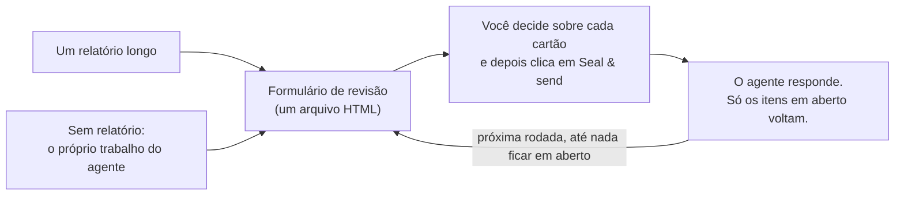

<div align="center">


# Vermilion · 朱批skill

**Revise relatórios longos de IA como um imperador.**

Sua IA escreve o memorial. Você segura o pincel vermelhão.

[English](README.md) · [简体中文](README.zh-CN.md) · [繁體中文](README.zh-TW.md) · [日本語](README.ja.md) · [한국어](README.ko.md) · [Español](README.es.md) · [Français](README.fr.md) · [Deutsch](README.de.md) · **Português (Brasil)** · [Русский](README.ru.md)

[](#instalação)
[](#o-que-você-recebe)
[](#o-que-você-recebe)
[](LICENSE)

<a href="assets/vermilion-demo.mp4"></a>

⭐ **Se o Vermilion for útil para você, dê uma estrela, por favor.** Isso ajuda outras pessoas a encontrá-lo.

</div>

---

## Por quê

Os agentes de IA agora escrevem relatórios longos: auditorias, planos de migração, revisões de design, resumos de pesquisa. Um relatório típico tem de 10 a 50 itens em que **você** precisa decidir, aprovar ou corrigir algo.

Ler o relatório não é o problema. **Dar o feedback é a parte penosa.** Você rola a tela, cita trechos, digita "sobre o item 7, acho que…" no chat. Você perde o controle do que já respondeu. O agente entende errado a qual item você se referia. E na semana seguinte ninguém sabe dizer o que foi decidido, nem em qual versão do texto.

Na China imperial, os ministros enviavam longos memoriais (奏章) ao trono. O imperador não respondia com ensaios. Ele escrevia uma decisão curta em cada um, com tinta vermelhão: o 朱批. **O Vermilion dá esse papel a você.** O agente coloca cada item em um cartão próprio, com as evidências, as opções e a recomendação dele. Você decide sobre cada cartão em um formulário. O agente lê suas respostas com exatidão, responde aos seus comentários e pergunta de novo só sobre o que ainda está em aberto.

**O resultado: decisões melhores e feedback melhor, com menos esforço.** Você vê cada decisão, e nada fica de fora. Cada resposta traz um motivo quando ele é necessário. O agente recebe respostas estruturadas em vez de um parágrafo para interpretar.

## Instalação

O Vermilion funciona no **Claude Code** e no **Codex**. Você precisa do Python 3.8 ou mais recente. Para rodar o autoteste opcional, você também precisa do Chrome, Chromium ou Edge.

**Claude Code**

```
/plugin marketplace add HaoranZhang122/vermilion-review
/plugin install vermilion@vermilion-review
```

Ou copie `skills/vermilion/` para `~/.claude/skills/` (para todos os projetos) ou para `.claude/skills/` (para um único projeto).

**Codex**

```
codex plugin marketplace add HaoranZhang122/vermilion-review
codex plugin add vermilion@vermilion-review
```

Ou copie `skills/vermilion/` para `~/.codex/skills/`.

## Como usar



**1. Comece.** Entregue ao agente um relatório longo, ou deixe que ele pule o relatório e apresente a você o resultado como um formulário de revisão:

| Ponto de partida | Claude Code | Codex |
|---|---|---|
| A partir de um relatório longo | `Use vermilion to turn docs/migration-report.md into a review form. ultracode` | `$vermilion Turn docs/migration-report.md into a review form.` |
| Sem relatório | `Plan the database migration, and give me the result as a Vermilion review instead of a long report. ultracode` | `$vermilion Plan the database migration, and give me the result as a review form instead of a long report.` |

(Você também pode pedir em português, por exemplo: "Use o vermilion para transformar docs/migration-report.md em um formulário de revisão. ultracode".)

No Codex, `$vermilion` aciona a skill.

**2. Responda.** Abra o formulário que o agente entregar a você, decida sobre cada cartão e clique em **Seal & send** (selar e enviar). Diga ao agente "salvo".

**3. Repita.** O agente lê suas respostas e envia um formulário mais curto, só com os itens em aberto, cada um com a resposta dele ao seu comentário. Quando nada mais estiver em aberto, ele escreve o registro final de decisões.

> **O modo Ultracode é altamente recomendado.** Para um relatório longo, deixe o agente rodar um fluxo de trabalho com vários agentes: um redator por cartão, um verificador independente por cartão, que o confere com a fonte, e uma verificação de consistência. Redatores que condensam relatórios longos costumam omitir ressalvas e alterar números. Os verificadores detectam isso. No Claude Code, adicione `ultracode` ao prompt (é preciso ativar a opção “Dynamic workflows” em `/config`). Sem o Ultracode, e no Codex, o agente segue as mesmas etapas de redator e de verificador, uma após a outra: veja [references/ultracode.md](skills/vermilion/references/ultracode.md) (em inglês).

**Experimente agora, sem agente:** clone o repositório e abra no navegador os arquivos em [`skills/vermilion/examples/demo/forms/`](skills/vermilion/examples/demo/forms/) (o próprio GitHub mostra arquivos HTML como código-fonte). Eles contêm uma revisão fictícia de uma migração de banco de dados: a rodada 1 vazia, a rodada 1 do jeito que um revisor a devolveu, e a rodada 2.

## O que você recebe

**Para você, o revisor**
- **Um cartão por decisão.** Cada cartão tem um resumo de uma linha, as evidências (expanda quando tiver dúvida), figuras, as opções com seus custos e riscos, e uma opção recomendada.
- **Decida rápido.** <kbd>A</kbd> aceita a recomendação. <kbd>1</kbd>–<kbd>9</kbd> selecionam uma opção. <kbd>J</kbd>/<kbd>K</kbd> passam de um cartão para outro. <kbd>N</kbd> pula para o próximo cartão sem resposta. <kbd>F</kbd> sinaliza um cartão. <kbd>C</kbd> abre um comentário. Um selo vermelhão (准 Aprovado, 改 Revisar, 驳 Rejeitado, 缓 Adiado, 问 Pergunta) carimba cada cartão sobre o qual você decide.
- **Diga o quanto você tem certeza.** Com certeza, inclinado ou sem certeza. Se você não tiver certeza, o agente explica mais na próxima rodada.
- **Motivos onde importam.** Se você discordar, pedir uma mudança ou selecionar "Outra", o cursor vai para a caixa de comentário, para você escrever uma frase com o motivo.
- **Seal & send.** Um clique lista o que está sem resposta, sem certeza ou sem motivo, salva suas respostas no arquivo e copia um resumo curto para o chat. O agente encontra sozinho o arquivo salvo se ele estiver na pasta do formulário, em Downloads ou na Área de Trabalho; caso contrário, informe o caminho a ele.
- **As rodadas seguintes são curtas.** Uma tabela com tudo o que está confirmado (você pode reabrir uma linha) e, só para cada item em aberto, um cartão com sua resposta anterior e a resposta do agente.

**Para o agente**
- Uma CLI em Python sem dependências (`vermilion.py`): `init`, `check`, `build`, `receive`, `next-round`, `revise`, `rebuild`, `answers`, `status`, `selftest`.
- `check` valida os cartões, os links e as figuras. Também dá uma pontuação de linguagem simples (cerca de 80% ASD-STE100, opcional).
- `receive` recusa um arquivo de outra revisão, uma prévia de rascunho, um arquivo não salvo ou um arquivo cujos cartões diferem dos do formulário emitido.
- `next-round` classifica cada item como Confirmado ou Em aberto, com um motivo. Ele escreve `DECISIONS_after_R<n>.md` e prepara o rascunho do próximo conjunto de cartões, com um `TODO(AI)` em cada lugar onde falta uma resposta. Nada pode sair da revisão sem uma decisão.

**Para o registro**
- **As respostas ficam dentro do arquivo HTML.** No Chrome e no Edge, o primeiro salvamento abre uma caixa de diálogo para salvar: escolha o próprio arquivo do formulário e confirme que quer substituí-lo; os salvamentos seguintes gravam direto nele. Outros navegadores e a prévia do VS Code baixam uma cópia atualizada.
- **Cada arquivo emitido e devolvido é congelado** (uma cópia somente leitura) e registrado com seu sha256 em `REVIEW_LOG.md`. Cada cartão leva uma impressão digital do seu texto, e o `receive` a confere com o formulário emitido, de modo que cada resposta pode ser rastreada até o conjunto de cartões que você recebeu.
- **As versões** são `R<rodada>.<revisão>`. As letras das opções nunca mudam de significado. Uma revisão (R1.1) corrige a redação e mantém suas respostas. Uma nova rodada (R2.0) pergunta só o que está em aberto.
- **Privado por design.** Não há servidor, nem chamada de rede, nem CDN. O formulário é um arquivo no seu disco.

## Comandos

| Comando | O que faz |
|---|---|
| `vermilion.py init --dir review --slug NAME --title TEXT` | Cria a pasta da revisão e a configuração dela. |
| `vermilion.py check --dir review --version R1.0` | Valida os cartões. Informa a pontuação de linguagem simples. |
| `vermilion.py build --dir review --version R1.0 [--draft]` | Gera uma prévia (`--draft`) ou emite o formulário: uma cópia de trabalho, uma cópia congelada e uma entrada no log. |
| `vermilion.py receive --dir review --find` | Recebe cada novo salvamento desta revisão na pasta da revisão, em ~/Downloads e em ~/Desktop, do mais antigo para o mais novo (ou informe `--file SAVED.html`). Congela cada um, extrai as respostas (`.md` e `.json`) e as registra no log. |
| `vermilion.py next-round --dir review [--dry-run] [--open ID ...]` | Classifica as respostas. Escreve o arquivo de decisões e prepara o rascunho da próxima rodada. |
| `vermilion.py revise --dir review --from R1.0 --to R1.1` | Copia um conjunto de cartões para uma revisão. |
| `vermilion.py build --dir review --version R1.1 --carry SAVED.html` | Emite uma revisão que mantém as respostas da rodada. |
| `vermilion.py rebuild --dir review --version R1.0 --out FILE` | Reconstrói um formulário emitido a partir do log e o compara byte a byte. |
| `vermilion.py answers SAVED.html` | Mostra as respostas de qualquer formulário. Não registra nada no log. |
| `vermilion.py status --dir review` | Mostra o log e em que ponto a revisão está. |
| `vermilion.py selftest FORM.html` | Roda o autoteste embutido do formulário em um navegador headless. |

Os detalhes estão em [SKILL.md](skills/vermilion/SKILL.md) e em [references/](skills/vermilion/references/) (em inglês): o esquema dos cartões, como escrever cartões, as regras de linguagem simples, rodadas e versões, e a receita do Ultracode.

## Perguntas frequentes

**Qual navegador?** No Chrome ou no Edge, o primeiro salvamento pergunta onde salvar: escolha o próprio arquivo do formulário. Firefox, Safari e a prévia do VS Code também funcionam: ao salvar, eles baixam uma cópia atualizada. Entregue essa cópia ao agente.

**Fechei a aba sem salvar.** Abra o mesmo arquivo no mesmo navegador. O formulário oferece as respostas que o navegador guardou.

**Posso confiar no que o agente diz que decidiu?** O arquivo de decisões lista cada item com seu status e o motivo. Cada resposta pode ser rastreada até uma cópia congelada do arquivo que você salvou, com seu sha256. Seus comentários chegam ao agente com as suas próprias palavras. O agente lê cada comentário e responde em cada cartão em aberto na próxima rodada.

**Funciona com outros agentes (Cursor, Gemini CLI)?** O Claude Code e o Codex têm suporte direto (veja Instalação). A CLI é Python puro e o SKILL.md é Markdown puro, então qualquer outro agente que consiga ler um arquivo e rodar um comando também pode segui-lo.

**Meus dados são enviados para algum lugar?** Não. O formulário não faz nenhuma requisição de rede. As figuras ficam embutidas no arquivo.

## Histórico de estrelas

Se o Vermilion poupar seu tempo, uma ⭐ é a forma mais fácil de agradecer e de ajudar outras pessoas a encontrá-lo.

<a href="https://star-history.com/#HaoranZhang122/vermilion-review&Date">
  <picture>
    <source media="(prefers-color-scheme: dark)" srcset="https://api.star-history.com/svg?repos=HaoranZhang122/vermilion-review&type=Date&theme=dark" />
    <source media="(prefers-color-scheme: light)" srcset="https://api.star-history.com/svg?repos=HaoranZhang122/vermilion-review&type=Date" />
    
  </picture>
</a>

## Autor

Haoran Jack Zhang · [@HaoranZhang122](https://github.com/HaoranZhang122)

Dúvidas e ideias: [abra uma issue](https://github.com/HaoranZhang122/vermilion-review/issues).

## Licença

MIT. Veja [LICENSE](LICENSE).
