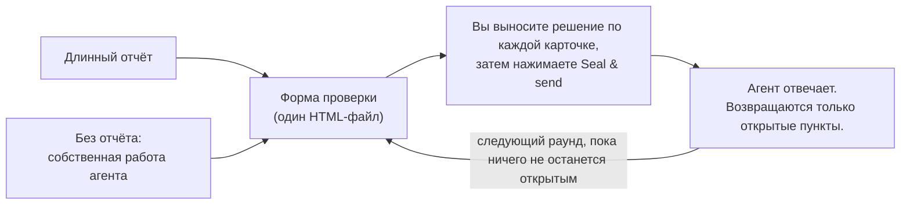

<div align="center">


# Granted · 准奏skill

**Проверяйте длинные отчёты ИИ, как император.**

Ваш ИИ пишет доклад. Киноварная кисть — у вас.

[English](README.md) · [简体中文](README.zh-CN.md) · [繁體中文](README.zh-TW.md) · [日本語](README.ja.md) · [한국어](README.ko.md) · [Español](README.es.md) · [Français](README.fr.md) · [Deutsch](README.de.md) · [Português (Brasil)](README.pt-BR.md) · **Русский**

[](#установка)
[](#что-вы-получаете)
[](#что-вы-получаете)
[](LICENSE)

<a href="assets/granted-demo.mp4"></a>

⭐ **Если Granted вам помогает, пожалуйста, поставьте ему звезду.** Так другим людям проще его найти.

</div>

---

## Зачем

ИИ-агенты теперь пишут длинные отчёты: аудиты, планы миграции, ревью архитектуры, сводки исследований. В типичном отчёте 10–50 пунктов, по которым **вы** должны что-то решить, одобрить или исправить.

Прочитать отчёт несложно. **Самое мучительное — дать обратную связь.** Вы прокручиваете текст, цитируете, пишете в чат «по пункту 7, я думаю…». Вы забываете, на что уже ответили. Агент неправильно понимает, какой пункт вы имели в виду. А через неделю никто не может сказать, что было решено и по какой версии текста.

В императорском Китае министры подавали трону длинные доклады (奏章). Император не писал в ответ трактатов. На каждом докладе он писал киноварью короткое решение. Самое известное, знакомое по любой дворцовой драме, — 准奏: «просьба удовлетворена». Отсюда и название Granted. **Granted даёт вам эту роль.** Агент помещает каждый пункт на отдельную карточку, с обоснованием, вариантами и своей рекомендацией. Вы выносите решение по каждой карточке в форме. Агент точно считывает ваши ответы, отвечает на ваши комментарии и снова спрашивает только о том, что ещё открыто.

**Итог: решения и обратная связь становятся лучше, а усилий нужно меньше.** Вы видите каждое решение, и ничего не пропускается. Каждый ответ, где это нужно, сопровождается причиной. Агент получает структурированные ответы, а не абзац, который нужно толковать.

## Установка

Granted работает в **Claude Code** и в **Codex**. Нужен Python 3.8 или новее. Для необязательного самотеста также нужен Chrome, Chromium или Edge.

**Claude Code**

```
/plugin marketplace add HaoranZhang122/granted-review
/plugin install granted@granted-review
```

Или скопируйте `skills/granted/` в `~/.claude/skills/` (для всех проектов) или в `.claude/skills/` (для одного проекта).

**Codex**

```
codex plugin marketplace add HaoranZhang122/granted-review
codex plugin add granted@granted-review
```

Или скопируйте `skills/granted/` в `~/.codex/skills/`.

## Как пользоваться



**1. Начните.** Дайте агенту длинный отчёт или позвольте ему обойтись без отчёта и выдать результат сразу в виде формы проверки:

| Начало | Claude Code | Codex |
|---|---|---|
| Из длинного отчёта | `Use the granted skill to turn docs/migration-report.md into a review form. ultracode` | `$granted Turn docs/migration-report.md into a review form.` |
| Без отчёта | `Plan the database migration, and give me the result as a Granted review instead of a long report. ultracode` | `$granted Plan the database migration, and give me the result as a review form instead of a long report.` |

(Можно просить и по-русски, например: «Используй skill granted, чтобы превратить docs/migration-report.md в форму проверки. ultracode».)

В Codex `$granted` вызывает skill.

**2. Ответьте.** Откройте форму, которую вам даст агент, вынесите решение по каждой карточке и нажмите **Seal & send** («Запечатать и отправить»). Скажите агенту «сохранено».

**3. Повторите.** Агент читает ваши ответы и присылает более короткую форму только с открытыми пунктами; в каждом из них есть его ответ на ваш комментарий. Когда открытых пунктов не остаётся, он пишет итоговый реестр решений.

> **Режим Ultracode настоятельно рекомендуется.** Для длинного отчёта позвольте агенту запустить многоагентный процесс: по одному автору на каждую карточку, по независимому верификатору на каждую карточку, который сверяет её с источником, и проверку согласованности. Авторы, которые сжимают длинные отчёты, часто теряют оговорки и меняют числа. Верификаторы это ловят. В Claude Code добавьте `ultracode` в запрос (для этого нужна настройка «Dynamic workflows» в `/config`). Без Ultracode, а также в Codex, агент выполняет те же шаги автора и верификатора по очереди: см. [references/ultracode.md](skills/granted/references/ultracode.md) (на английском).

**Попробуйте прямо сейчас, без агента:** клонируйте репозиторий и откройте в браузере файлы из [`skills/granted/examples/demo/forms/`](skills/granted/examples/demo/forms/) (сам GitHub показывает HTML-файлы как исходный код). В них вымышленная проверка миграции базы данных: пустой раунд 1, раунд 1 в том виде, в каком его вернул проверяющий, и раунд 2.

## Что вы получаете

**Для вас, проверяющего**
- **Одна карточка на одно решение.** На каждой карточке есть резюме в одну строку, обоснование (раскройте его, если сомневаетесь), рисунки, варианты с их стоимостью и рисками и один рекомендуемый вариант.
- **Решайте быстро.** <kbd>A</kbd> принимает рекомендацию. <kbd>1</kbd>–<kbd>9</kbd> выбирают вариант. <kbd>J</kbd>/<kbd>K</kbd> переходят между карточками. <kbd>N</kbd> переходит к следующей карточке без ответа. <kbd>F</kbd> помечает карточку флажком. <kbd>C</kbd> открывает комментарий. На каждую карточку, по которой вы приняли решение, ставится печать: 准 Одобрено — киноварью, а 改 Доработать, 驳 Отклонено, 缓 Отложено и 问 Вопрос — каждая своим цветом.
- **Скажите, насколько вы уверены.** Уверен, склоняюсь или не уверен. Если вы не уверены, агент объяснит подробнее в следующем раунде.
- **Причины там, где они важны.** Если вы не согласны, запрашиваете доработку или выбираете «Другое», курсор переходит в поле комментария, чтобы вы написали причину одним предложением.
- **Seal & send.** Один щелчок перечисляет, что осталось без ответа, в чём вы не уверены и где нет причины, сохраняет ваши ответы в файл и копирует краткую сводку для чата. Агент сам находит сохранённый файл, если он лежит в папке формы, в «Загрузках» или на рабочем столе; иначе укажите ему путь.
- **Следующие раунды короткие.** Таблица со всем, что подтверждено (любую строку можно открыть заново), а карточки — только для открытых пунктов, с вашим прежним ответом и ответом агента.

**Для агента**
- CLI на Python без зависимостей (`granted.py`): `init`, `check`, `build`, `receive`, `next-round`, `revise`, `rebuild`, `answers`, `status`, `selftest`.
- `check` проверяет карточки, ссылки и рисунки. Ещё он выдаёт оценку простоты языка (примерно 80% ASD-STE100, по желанию).
- `receive` отклоняет файл другой проверки, черновой предпросмотр, несохранённый файл или файл, карточки которого отличаются от выданной формы.
- `next-round` относит каждый пункт к подтверждённым (Confirmed) или открытым (Open), с причиной. Он пишет `DECISIONS_after_R<n>.md` и готовит черновик следующего набора карточек, с `TODO(AI)` в каждом месте, где нужен ответ. Ни один пункт не может выпасть из проверки без решения.

**Для протокола**
- **Ответы хранятся внутри HTML-файла.** В Chrome и Edge первое сохранение открывает диалог сохранения: выберите сам файл формы и подтвердите замену, и дальше сохранения пишутся прямо в него. Другие браузеры и предпросмотр VS Code скачивают обновлённую копию.
- **Каждый выданный и возвращённый файл замораживается** (копия только для чтения) и записывается в журнал `REVIEW_LOG.md` вместе со своим sha256. Каждая карточка несёт отпечаток своего текста, и `receive` сверяет его с выданной формой, поэтому каждый ответ можно проследить до того набора карточек, который вы получили.
- **Версии** имеют вид `R<round>.<revision>`. Буквы вариантов никогда не меняют свой смысл. Ревизия (R1.1) исправляет формулировки и сохраняет ваши ответы. Новый раунд (R2.0) спрашивает только о том, что открыто.
- **Приватность заложена в устройство.** Нет сервера, нет сетевых запросов и нет CDN. Форма — это один файл на вашем диске.

## Команды

| Команда | Что делает |
|---|---|
| `granted.py init --dir review --slug NAME --title TEXT` | Создаёт папку проверки и её конфигурацию. |
| `granted.py check --dir review --version R1.0` | Проверяет карточки. Сообщает оценку простоты языка. |
| `granted.py build --dir review --version R1.0 [--draft]` | Собирает предпросмотр (`--draft`) или выдаёт форму: рабочую копию, замороженную копию и запись в журнале. |
| `granted.py receive --dir review --find` | Принимает каждое новое сохранение этой проверки из папки проверки, ~/Downloads и ~/Desktop, начиная с самого старого (или укажите `--file SAVED.html`). Замораживает каждое, извлекает его ответы (`.md` и `.json`) и записывает их в журнал. |
| `granted.py next-round --dir review [--dry-run] [--open ID ...]` | Классифицирует ответы. Пишет файл решений и готовит черновик следующего раунда. |
| `granted.py revise --dir review --from R1.0 --to R1.1` | Копирует набор карточек для ревизии. |
| `granted.py build --dir review --version R1.1 --carry SAVED.html` | Выдаёт ревизию, которая сохраняет ответы раунда. |
| `granted.py rebuild --dir review --version R1.0 --out FILE` | Пересобирает выданную форму по журналу и сравнивает её побайтно. |
| `granted.py answers SAVED.html` | Выводит ответы любой формы. Ничего не записывает в журнал. |
| `granted.py status --dir review` | Показывает журнал и текущее состояние проверки. |
| `granted.py selftest FORM.html` | Запускает встроенный самотест формы в браузере без интерфейса (headless). |

Подробности — в [SKILL.md](skills/granted/SKILL.md) и [references/](skills/granted/references/) (на английском): схема карточек, как писать карточки, правила простого языка, раунды и версии, а также рецепт Ultracode.

## Частые вопросы

**Какой браузер?** В Chrome или Edge первое сохранение спрашивает, куда сохранить: выберите сам файл формы. Firefox, Safari и предпросмотр VS Code тоже подходят: при сохранении скачивается обновлённая копия. Отдайте эту копию агенту.

**Я закрыл вкладку, не сохранив.** Откройте тот же файл в том же браузере. Форма предложит ответы, которые сохранил браузер.

**Можно ли верить тому, что, по словам агента, было решено?** Файл решений перечисляет каждый пункт с его статусом и причиной. Каждый ответ можно проследить до замороженной копии сохранённого вами файла, с её sha256. Ваши комментарии доходят до агента слово в слово, как вы их написали. Агент читает каждый комментарий и отвечает на каждой открытой карточке в следующем раунде.

**Работает ли это с другими агентами (Cursor, Gemini CLI)?** Claude Code и Codex поддерживаются напрямую (см. «Установка»). CLI — это обычный Python, а SKILL.md — обычный Markdown, поэтому любой другой агент, который умеет читать файл и запускать команду, тоже может по нему работать.

**Мои данные куда-нибудь отправляются?** Нет. Форма не делает сетевых запросов. Рисунки встроены в файл.

## История звёзд

Если Granted экономит вам время, ⭐ — самый простой способ сказать спасибо и помочь другим людям его найти.

<a href="https://star-history.com/#HaoranZhang122/granted-review&Date">
  <picture>
    <source media="(prefers-color-scheme: dark)" srcset="https://api.star-history.com/svg?repos=HaoranZhang122/granted-review&type=Date&theme=dark" />
    <source media="(prefers-color-scheme: light)" srcset="https://api.star-history.com/svg?repos=HaoranZhang122/granted-review&type=Date" />
    
  </picture>
</a>

## Автор

Haoran Jack Zhang · [@HaoranZhang122](https://github.com/HaoranZhang122)

Вопросы и идеи: [откройте issue](https://github.com/HaoranZhang122/granted-review/issues).

## Лицензия

BSD-2-Clause. См. [LICENSE](LICENSE).
