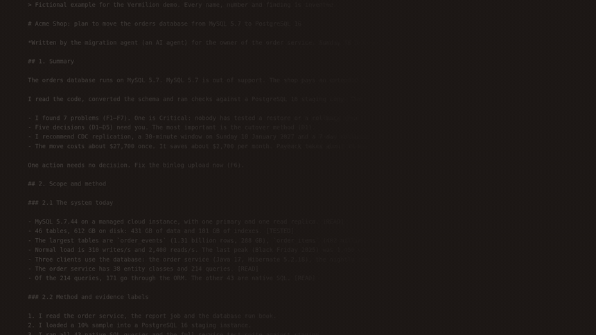
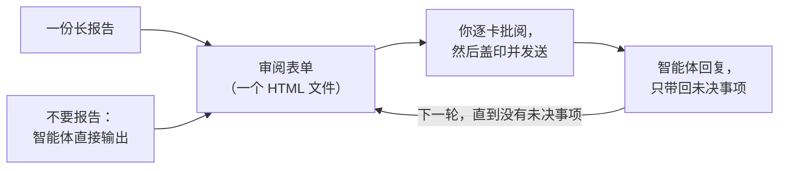

<div align="center">


# 朱批skill · Vermilion

**像皇帝批阅奏章一样，审阅 AI 写的长报告。**

AI 写奏章，你执朱笔。

[English](README.md) · **简体中文** · [繁體中文](README.zh-TW.md) · [日本語](README.ja.md) · [Español](README.es.md)

[](#安装)
[](#你能得到什么)
[](#你能得到什么)
[](LICENSE)

<a href="assets/vermilion-demo.mp4"></a>

</div>

---

## 为什么需要它

现在的 AI 智能体会写很长的报告：审计、迁移方案、设计评审、研究总结。一份报告里常常有 10 到 50 个事项，需要**你**来决定、批准或纠正。

读报告不难，**难的是给反馈**。你要来回翻页、引用原文，在对话框里打"关于第 7 条，我觉得……"。你记不清哪些已经答过，智能体也会弄错你指的是哪一条。过一周，没人说得清当时定了什么，又是基于哪个版本的文字。

古代大臣把长篇奏章呈给皇帝。皇帝不写长文回复，只在每份奏章上用朱笔写下简短的决定，这就是"朱批"。**朱批skill 让你担当这个角色。** 智能体把每个事项写成一张卡片，附上证据、选项和它的建议。你在表单里逐卡批阅。智能体准确读取你的答复，回应你的每条评论，下一轮只问仍未决定的事项。

**结果：决定更好，反馈更好，花的力气更少。** 每个决定你都看得到，不会漏掉；需要理由的地方都有理由；智能体拿到的是结构化的答复，而不是一段需要猜测的话。

## 安装

**作为 Claude Code 插件：**

```
/plugin marketplace add HaoranZhang122/vermilion-review
/plugin install vermilion@vermilion-review
```

**或作为普通 skill：** 把 `skills/vermilion/` 复制到 `~/.claude/skills/`（所有项目可用）或 `.claude/skills/`（仅当前项目）。

需要 Python 3.8 或更高版本。如需运行可选的自检，还需要 Chrome、Chromium 或 Edge。

## 如何使用



**1. 开始。** 把一份长报告交给智能体；或者跳过报告，让它直接把结果做成审阅表单：

```
Use vermilion to turn docs/migration-report.md into a review form. ultracode
```

```
Plan the database migration, and give me the result as a Vermilion review instead of a long report. ultracode
```

（用中文提问也可以，例如："用 vermilion 把 docs/migration-report.md 做成审阅表单。ultracode"）

**2. 批阅。** 打开智能体给你的表单，逐卡作答，然后点 **Seal & send（盖印并发送）**，再告诉智能体"已保存"。

**3. 循环。** 智能体读取你的答复，发给你一个更短的表单：只有未决事项，每一项都附有它对你评论的回复。所有事项都定下来后，它会写出最终的决定记录。

> **强烈推荐使用 Ultracode 模式。** 报告很长时，让智能体运行多智能体工作流：每张卡片一个撰写者，每张卡片一个独立核查者对照原始材料检查，最后做一次一致性检查。浓缩长报告的撰写者容易丢掉限定语、改错数字，核查者能发现这些问题。详见 [references/ultracode.md](skills/vermilion/references/ultracode.md)（英文）。

**不用智能体，现在就试试：** 克隆本仓库，在浏览器里打开 [`skills/vermilion/examples/demo/forms/`](skills/vermilion/examples/demo/forms/) 中的文件（GitHub 网页上 HTML 文件只显示源码）。里面是一个虚构的数据库迁移评审：空白的第一轮、审阅人交回的第一轮，以及第二轮。

## 你能得到什么

**对你（审阅人）**
- **一个决定一张卡片。** 每张卡片有一句话摘要、证据（有疑问时再展开）、图表、各选项的代价与风险，以及一个推荐选项。
- **快速批阅。** <kbd>A</kbd> 接受推荐；<kbd>1</kbd>–<kbd>9</kbd> 选择选项；<kbd>J</kbd>/<kbd>K</kbd> 在卡片间移动；<kbd>N</kbd> 跳到下一张未答的卡片；<kbd>F</kbd> 标记待讨论；<kbd>C</kbd> 写评论。每张你决定过的卡片都会盖上朱印（准、改、驳、缓、问）。
- **说明你有多确定。** 确定、倾向或不确定。如果你不确定，智能体会在下一轮多做解释。
- **需要理由的地方要理由。** 当你选择不同意、要求修改或"其他"时，光标会自动进入评论框，请你写一句理由。
- **盖印并发送。** 一键列出未答、不确定或缺少理由的卡片，把答复保存进文件，并复制一段给智能体的摘要。保存的文件如果在表单所在文件夹、"下载"或桌面，智能体能自己找到；否则告诉它路径。
- **后续轮次很短。** 一张表列出所有已确认的事项（任何一行都可以重新打开），只有未决事项才有卡片，并附上你上一轮的答复和智能体的回复。

**对智能体**
- 零依赖的 Python 命令行工具（`vermilion.py`）：`init`、`check`、`build`、`receive`、`next-round`、`revise`、`rebuild`、`answers`、`status`、`selftest`。
- `check` 校验卡片、链接和图表，并给出简明语言评分（约 80% ASD-STE100，可选）。
- `receive` 会拒收：其他评审的文件、草稿预览、从未保存过的文件，以及卡片与发出的表单不一致的文件。
- `next-round` 把每个事项分为"已确认"或"未决"并写明原因，写出 `DECISIONS_after_R<n>.md`，并起草下一轮的卡片，在每个需要回复的地方留下 `TODO(AI)`。任何事项都不会在没有决定的情况下从评审中消失。

**对记录**
- **答复保存在 HTML 文件里。** 在 Chrome 和 Edge 中，第一次保存会弹出保存对话框：选择表单文件本身并确认替换，之后的保存会直接写入该文件。其他浏览器和 VS Code 预览会下载一份更新后的副本。
- **每个发出和交回的文件都会被冻结**（只读副本），并连同 sha256 记录在 `REVIEW_LOG.md` 中。每张卡片都带有内容指纹，`receive` 会与发出的表单核对，所以每条答复都能追溯到你当时拿到的那套卡片。
- **版本号**是 `R<轮次>.<修订>`。选项字母的含义永不改变。修订版（R1.1）只改措辞并保留你的答复；新一轮（R2.0）只问未决事项。
- **隐私优先。** 没有服务器，没有网络请求，没有 CDN。表单就是你磁盘上的一个文件。

## 命令

| 命令 | 作用 |
|---|---|
| `vermilion.py init --dir review --slug NAME --title TEXT` | 创建评审文件夹和配置文件。 |
| `vermilion.py check --dir review --version R1.0` | 校验卡片，给出简明语言评分。 |
| `vermilion.py build --dir review --version R1.0 [--draft]` | 生成预览（`--draft`），或正式发出表单：一份工作副本、一份冻结副本和一条日志。 |
| `vermilion.py receive --dir review --find` | 按时间顺序接收评审文件夹、~/Downloads 和 ~/Desktop 中本评审的所有新保存（或用 `--file SAVED.html` 指定）。冻结每一份，提取答复（`.md` 和 `.json`）并记录。 |
| `vermilion.py next-round --dir review [--dry-run] [--open ID ...]` | 分类答复，写出决定文件，起草下一轮。 |
| `vermilion.py revise --dir review --from R1.0 --to R1.1` | 为修订版复制一套卡片。 |
| `vermilion.py build --dir review --version R1.1 --carry SAVED.html` | 发出保留本轮答复的修订版。 |
| `vermilion.py rebuild --dir review --version R1.0 --out FILE` | 依据日志重建已发出的表单，并逐字节比对。 |
| `vermilion.py answers SAVED.html` | 打印任意表单中的答复，不记录日志。 |
| `vermilion.py status --dir review` | 显示日志和评审进度。 |
| `vermilion.py selftest FORM.html` | 在无头浏览器中运行表单自带的自检。 |

详细说明见 [SKILL.md](skills/vermilion/SKILL.md) 和 [references/](skills/vermilion/references/)（英文）：卡片格式、如何写卡片、简明语言规则、轮次与版本，以及 Ultracode 做法。

## 常见问题

**用哪个浏览器？** 在 Chrome 或 Edge 中，第一次保存会询问保存位置：选择表单文件本身。Firefox、Safari 和 VS Code 预览也可以用：保存时会下载一份更新后的副本，把这份副本交给智能体即可。

**我没保存就关掉了页面。** 用同一个浏览器打开同一个文件，表单会找回浏览器里保留的答复。

**我能信任智能体说的决定吗？** 决定文件列出每个事项的状态和原因。每条答复都能追溯到你保存的那个文件的冻结副本及其 sha256。你的评论作为你的原话交给智能体；智能体会读每一条评论，并在下一轮的每张未决卡片上回复。

**能用于其他智能体吗（Codex、Cursor、Gemini CLI）？** 命令行工具是纯 Python，SKILL.md 是纯 Markdown。任何能读文件、能运行命令的智能体都能照着用。

**我的数据会被发送出去吗？** 不会。表单不发出任何网络请求，图表都嵌在文件里。

## 作者

Haoran Jack Zhang · [@HaoranZhang122](https://github.com/HaoranZhang122)

## 许可证

MIT。见 [LICENSE](LICENSE)。
