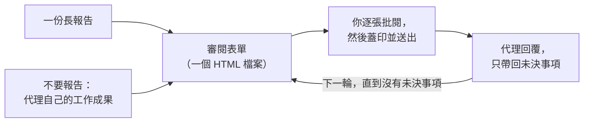

<div align="center">


# 朱批skill · Vermilion

**像皇帝批閱奏章一樣，審閱 AI 寫的長報告。**

AI 寫奏章，你執朱筆。

[English](README.md) · [简体中文](README.zh-CN.md) · **繁體中文** · [日本語](README.ja.md) · [한국어](README.ko.md) · [Español](README.es.md) · [Français](README.fr.md) · [Deutsch](README.de.md) · [Português (Brasil)](README.pt-BR.md) · [Русский](README.ru.md)

[](#安裝)
[](#你能得到什麼)
[](#你能得到什麼)
[](LICENSE)

<a href="assets/vermilion-demo.mp4"></a>

⭐ **如果朱批skill 對你有幫助，請按個 Star。** 這能讓更多人發現它。

</div>

---

## 為什麼需要它

現在的 AI 代理會寫很長的報告：稽核、遷移方案、設計審查、研究摘要。一份報告裡常常有 10 到 50 個事項，需要**你**來決定、核准或更正。

讀報告不難，**難的是給回饋**。你要來回捲動、引用原文，在對話框裡打「關於第 7 項，我覺得……」。你記不清哪些已經回覆過，代理也會弄錯你指的是哪一項。過一週，沒人說得清當時決定了什麼，又是根據哪個版本的文字。

古代大臣把長篇奏章呈給皇帝。皇帝不寫長文回覆，只在每份奏章上用朱筆寫下簡短的決定，這就是「朱批」。**朱批skill 讓你擔任這個角色。** 代理把每個事項寫成一張卡片，附上證據、選項和它的建議。你在表單裡逐張批閱。代理準確讀取你的回覆，回應你的每則評論，下一輪只問仍未決定的事項。

**結果：決定更好，回饋更好，花的力氣更少。** 每個決定你都看得到，不會遺漏；需要理由的地方都有理由；代理拿到的是結構化的回覆，而不是一段需要猜測的話。

## 安裝

朱批skill 可以在 **Claude Code** 和 **Codex** 中使用。需要 Python 3.8 或更新版本。如要執行選用的自我檢查，還需要 Chrome、Chromium 或 Edge。

**Claude Code**

```
/plugin marketplace add HaoranZhang122/vermilion-review
/plugin install vermilion@vermilion-review
```

或者把 `skills/vermilion/` 複製到 `~/.claude/skills/`（所有專案可用）或 `.claude/skills/`（僅限單一專案）。

**Codex**

```
codex plugin marketplace add HaoranZhang122/vermilion-review
codex plugin add vermilion@vermilion-review
```

或者把 `skills/vermilion/` 複製到 `~/.codex/skills/`。

## 如何使用



**1. 開始。** 把一份長報告交給代理；或者跳過報告，讓它直接把結果做成審閱表單：

| 開始方式 | Claude Code | Codex |
|---|---|---|
| 從一份長報告開始 | `Use vermilion to turn docs/migration-report.md into a review form. ultracode` | `$vermilion Turn docs/migration-report.md into a review form.` |
| 不要報告 | `Plan the database migration, and give me the result as a Vermilion review instead of a long report. ultracode` | `$vermilion Plan the database migration, and give me the result as a review form instead of a long report.` |

（用中文提問也可以，例如：「用 vermilion 把 docs/migration-report.md 做成審閱表單。ultracode」）

在 Codex 中，`$vermilion` 會呼叫這個 skill。

**2. 作答。** 開啟代理給你的表單，逐張批閱，然後按 **Seal & send（蓋印並送出）**，再告訴代理「已儲存」。

**3. 重複。** 代理讀取你的回覆，傳給你一個更短的表單：只有未決事項，每一項都附有它對你評論的回覆。沒有未決事項時，它會寫出最終的決定紀錄。

> **強烈建議使用 Ultracode 模式。** 報告很長時，讓代理執行多代理工作流程：每張卡片由一位撰寫者負責，再由一位獨立的查核者對照原始資料檢查，並做一次一致性檢查。撰寫者在濃縮長報告時，常會漏掉限定語、改錯數字；查核者能抓出這些問題。在 Claude Code 中，在提示詞裡加上 `ultracode`（需要在 `/config` 中開啟「Dynamic workflows」設定）。沒有 Ultracode 時，以及在 Codex 中，代理會依序完成同樣的撰寫與查核步驟，詳見 [references/ultracode.md](skills/vermilion/references/ultracode.md)（英文）。

**不用代理，現在就試試：** 複製（clone）本儲存庫，在瀏覽器裡開啟 [`skills/vermilion/examples/demo/forms/`](skills/vermilion/examples/demo/forms/) 中的檔案（GitHub 本身只會把 HTML 檔案顯示成原始碼）。裡面是一個虛構的資料庫遷移審查：空白的第一輪、審閱人交回的第一輪，以及第二輪。

## 你能得到什麼

**對你（審閱人）**
- **一個決定一張卡片。** 每張卡片有一句話摘要、證據（有疑問時再展開）、圖表、各選項的代價與風險，以及一個建議選項。
- **快速批閱。** <kbd>A</kbd> 接受建議；<kbd>1</kbd>–<kbd>9</kbd> 選擇選項；<kbd>J</kbd>/<kbd>K</kbd> 在卡片間移動；<kbd>N</kbd> 跳到下一張未回覆的卡片；<kbd>F</kbd> 標記待討論；<kbd>C</kbd> 寫評論。每張你決定過的卡片都會蓋上朱印（准、改、驳、缓、问）。
- **說明你有多確定。** 確定、傾向或不確定。如果你不確定，代理會在下一輪多做解釋。
- **需要理由的地方要理由。** 當你選擇不同意、要求修改或「其他」時，游標會自動進入評論框，請你寫一句理由。
- **蓋印並送出。** 一鍵列出未回覆、不確定或缺少理由的卡片，把回覆儲存進檔案，並複製一段給代理的摘要。儲存的檔案如果在表單所在資料夾、「下載」或桌面，代理能自己找到；否則告訴它路徑。
- **後續輪次很短。** 一張表列出所有已確認的事項（任何一列都可以重新開啟），只有未決事項才有卡片，並附上你上一輪的回覆和代理的回覆。

**對代理**
- 零依賴的 Python 命令列工具（`vermilion.py`）：`init`、`check`、`build`、`receive`、`next-round`、`revise`、`rebuild`、`answers`、`status`、`selftest`。
- `check` 驗證卡片、連結和圖表，並給出淺白語言評分（約 80% ASD-STE100，選用）。
- `receive` 會拒收：其他審查的檔案、草稿預覽、從未儲存過的檔案，以及卡片與發出的表單不一致的檔案。
- `next-round` 把每個事項分為「已確認」或「未決」並寫明原因，寫出 `DECISIONS_after_R<n>.md`，並起草下一輪的卡片，在每個需要回覆的地方留下 `TODO(AI)`。任何事項都不會在沒有決定的情況下從審查中消失。

**對紀錄**
- **回覆儲存在 HTML 檔案裡。** 在 Chrome 和 Edge 中，第一次儲存會跳出儲存對話框：選擇表單檔案本身並確認取代，之後的儲存會直接寫入該檔案。其他瀏覽器和 VS Code 預覽會下載一份更新後的副本。
- **每個發出和交回的檔案都會被凍結**（唯讀副本），並連同 sha256 記錄在 `REVIEW_LOG.md` 中。每張卡片都帶有內容指紋，`receive` 會與發出的表單核對，所以每則回覆都能追溯到你當時拿到的那組卡片。
- **版本號**是 `R<輪次>.<修訂>`。選項字母的含義永不改變。修訂版（R1.1）只改措辭並保留你的回覆；新一輪（R2.0）只問未決事項。
- **隱私優先。** 沒有伺服器，沒有網路請求，沒有 CDN。表單就是你磁碟上的一個檔案。

## 命令

| 命令 | 作用 |
|---|---|
| `vermilion.py init --dir review --slug NAME --title TEXT` | 建立審查資料夾和設定檔。 |
| `vermilion.py check --dir review --version R1.0` | 驗證卡片，給出淺白語言評分。 |
| `vermilion.py build --dir review --version R1.0 [--draft]` | 產生預覽（`--draft`），或正式發出表單：一份工作副本、一份凍結副本和一筆紀錄。 |
| `vermilion.py receive --dir review --find` | 依時間順序接收審查資料夾、~/Downloads 和 ~/Desktop 中本審查的所有新儲存（或用 `--file SAVED.html` 指定）。凍結每一份，擷取回覆（`.md` 和 `.json`）並記錄。 |
| `vermilion.py next-round --dir review [--dry-run] [--open ID ...]` | 分類回覆，寫出決定檔，起草下一輪。 |
| `vermilion.py revise --dir review --from R1.0 --to R1.1` | 為修訂版複製一組卡片。 |
| `vermilion.py build --dir review --version R1.1 --carry SAVED.html` | 發出保留本輪回覆的修訂版。 |
| `vermilion.py rebuild --dir review --version R1.0 --out FILE` | 依據紀錄重建已發出的表單，並逐位元組比對。 |
| `vermilion.py answers SAVED.html` | 印出任意表單中的回覆，不寫入紀錄。 |
| `vermilion.py status --dir review` | 顯示紀錄和審查進度。 |
| `vermilion.py selftest FORM.html` | 在無頭瀏覽器中執行表單內建的自我檢查。 |

詳細說明見 [SKILL.md](skills/vermilion/SKILL.md) 和 [references/](skills/vermilion/references/)（英文）：卡片格式、如何寫卡片、淺白語言規則、輪次與版本，以及 Ultracode 做法。

## 常見問題

**用哪個瀏覽器？** 在 Chrome 或 Edge 中，第一次儲存會詢問儲存位置：選擇表單檔案本身。Firefox、Safari 和 VS Code 預覽也可以用：儲存時會下載一份更新後的副本，把這份副本交給代理即可。

**我沒儲存就關掉了分頁。** 用同一個瀏覽器開啟同一個檔案，表單會提示你還原瀏覽器保留下來的回覆。

**代理說它做了哪些決定，我能相信嗎？** 決定檔列出每個事項的狀態和原因。每則回覆都能追溯到你儲存的那個檔案的凍結副本及其 sha256。你的評論會以你的原話交給代理；代理會讀過每一則評論，並在下一輪的每張未決卡片上回覆。

**可以搭配其他代理使用嗎（Cursor、Gemini CLI）？** Claude Code 和 Codex 都有直接支援（見「安裝」）。命令列工具是純 Python，SKILL.md 是純 Markdown，所以其他任何能讀取檔案、執行命令的代理也都能照著使用。

**我的資料會被傳送出去嗎？** 不會。表單不會發出任何網路請求，圖表都內嵌在檔案裡。

## Star 趨勢

如果朱批skill 幫你省了時間，按個 ⭐ 是最簡單的感謝方式，也能幫助更多人發現它。

<a href="https://star-history.com/#HaoranZhang122/vermilion-review&Date">
  <picture>
    <source media="(prefers-color-scheme: dark)" srcset="https://api.star-history.com/svg?repos=HaoranZhang122/vermilion-review&type=Date&theme=dark" />
    <source media="(prefers-color-scheme: light)" srcset="https://api.star-history.com/svg?repos=HaoranZhang122/vermilion-review&type=Date" />
    
  </picture>
</a>

## 作者

Haoran Jack Zhang · [@HaoranZhang122](https://github.com/HaoranZhang122)

問題和建議：請[提交 issue](https://github.com/HaoranZhang122/vermilion-review/issues)。

## 授權

MIT。見 [LICENSE](LICENSE)。
